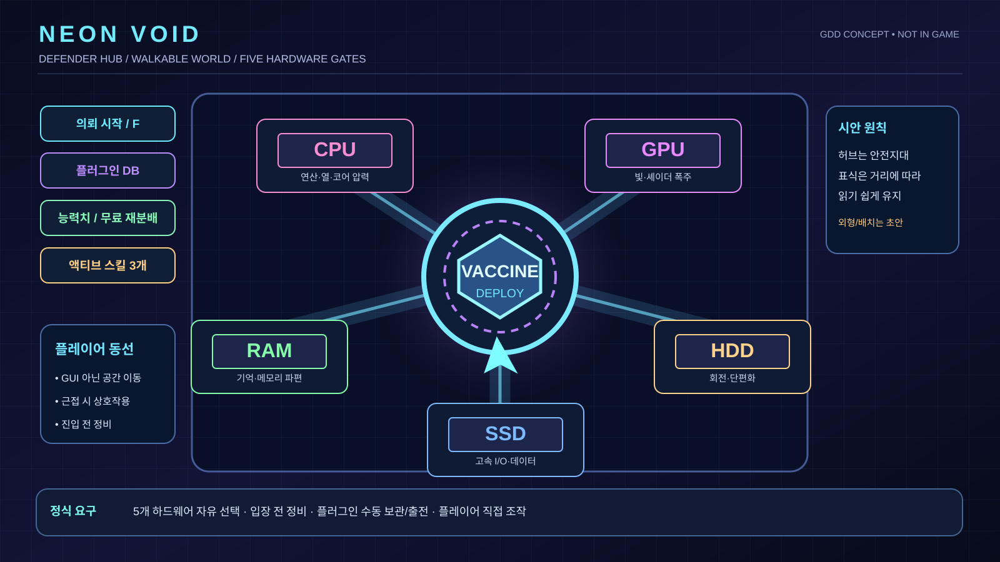
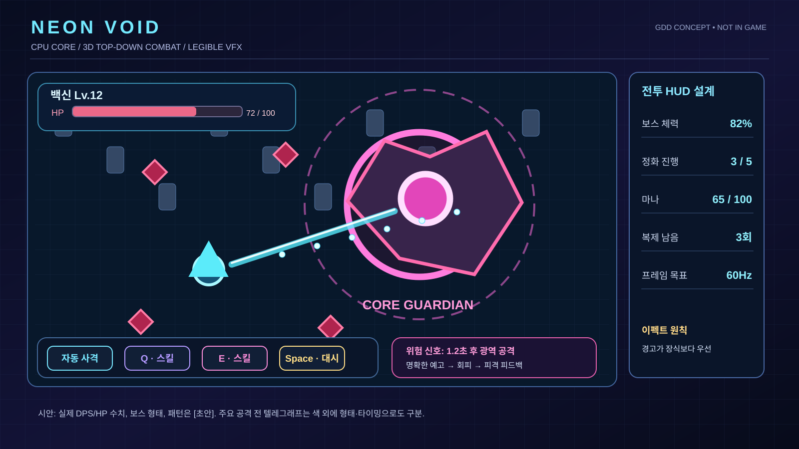
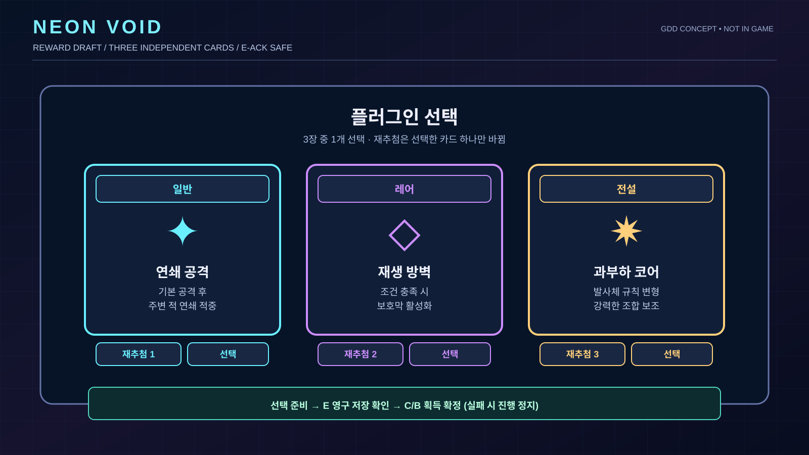
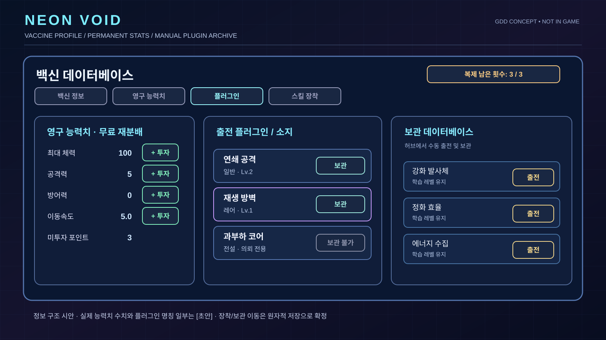
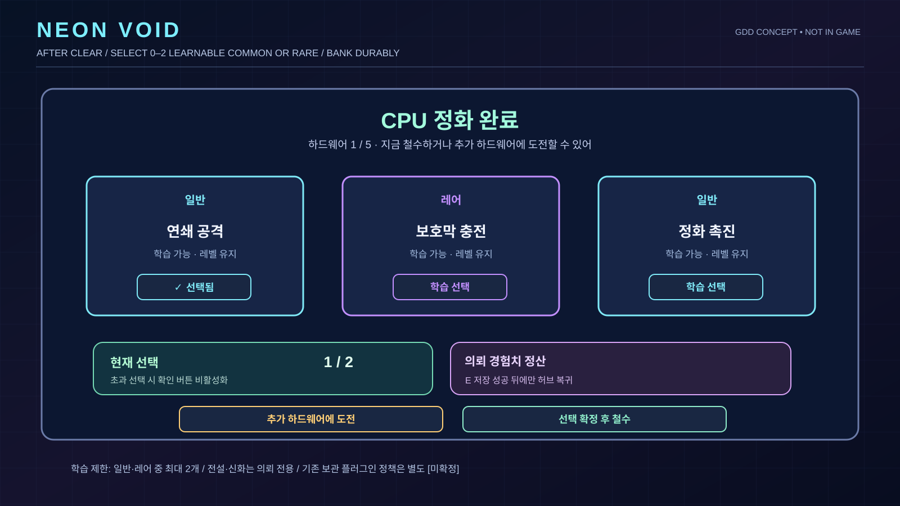
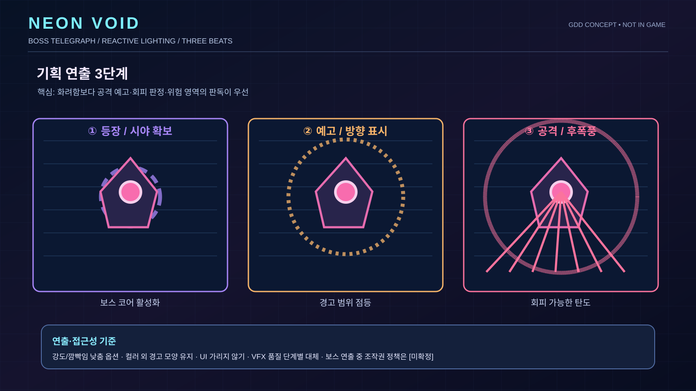

# Neon Void — 신규 게임 시스템 기획서 (GDD v1.0)

> **보관 목적 (Python-only 정리본, 2026-11-20):** 이 문서는 이전 Godot 리워크 시기의 **기획 기록 원본**이며, 현재 패키지에서 실행되는 것은 `python/`의 Tkinter 예시 게임뿐입니다. 아래의 Godot 씬/모듈, 개발 단계, 구현 상태, QA 관련 서술은 과거 시점의 참고 자료로서 **이 정리본에 구현되어 있다는 뜻이 아닙니다.** 향후 신작 엔진/설계를 확정하기 전에는 이 문서를 그대로 현재 명세로 채택하지 마세요. 원문 본문은 보존했습니다.

> **문서 상태:** 게임 시스템 **기획 확정 사항 + 밸런싱 초안** / **코드 구현 완료를 의미하지 않음**  
> **작성 기준일:** 2026-11-17 (KST)  
> **대상:** Neon Void Godot 4 3D 게임의 차기 시스템 개편  
> **기획 출처:** 사용자와 합의한 1~8차 설계(총 62개 질문) + 이후 8~12분 플레이타임 기준의 수치 설계  
> **관련:** [프로젝트 안내](../README.md) · [Python 참고 코드 구조](PYTHON_REFERENCE.md) · [에셋 권리 기록](ASSET_CREDITS.md) · [콘셉트 시안](assets/gdd/README.md)  
> **상세화:** 2026-11-18 / 개발 전달용 16~24장 추가. 원문 [확정]을 유지하며 새 제안은 [초안]·[미확정]으로 명시.

## 문서 사용 원칙

이 문서는 **새로운 목표 게임의 요구사항(신규 GDD)**을 기록한다. 현재 main의 구현 상태를 설명하는 릴리스 노트가 아니다. **2026-11-18 현재 README상** `main`은 버전 선택 화면(`scenes/launcher.tscn`)을 제공하고, 이전 4개 OS 구역 게임(`scenes/main.tscn`)과 별도의 5하드웨어 리워크(`scenes/rework/integration/rework_main.tscn`)를 선택할 수 있다. 기존 Godot판은 4개 OS 구역(CPU CORE, MEMORY SECTOR, STORAGE VAULT, NETWORK GRID)을 가지며 신규 GDD와 다르다. **리워크 실행 가능 사실이 GDD의 모든 최종 목표 구현·QA 완료를 뜻하지 않는다.**

- **[확정]**: 사용자가 직접 선택하거나 명시한 규칙. 개발 시 임의 변경 금지.
- **[초안 v0.1]**: 아직 승인받지 않은 수치, 공식, 예시 구현·콘텐츠. 실제 플레이 QA로 조정 가능.
- **[미확정]**: 사용자 결정이 없거나 기존 답변만으로 확정할 수 없는 정책. 기본 구현을 임의로 최종 규칙이라 주장하지 않는다.
- **[현재 구현]**: 기존 게임의 기준일 당시 동작. [확정]과 다르면 신규 개발 이슈 및 저장 데이터 마이그레이션을 통해 전환한다.
- 기존 Python/Tk 코드는 python/ 아래 보존. 레거시 사용자 데이터(save.json, profile.json, settings.json, antivirus_db.json, os_checkpoint.json)를 자동 변경·파괴하지 않는다. 새로운 저장 스키마는 별도 슬롯/버전으로 만들고 명시적 사용자 동의와 백업·검증을 거친다.
- 이 문서 작성만으로 게임 코드, 게임 밸런스 또는 QA 결과가 변경되는 것은 아니다.

## 목차

1. 게임 정체성과 핵심 루프
2. 세계·맵·하드웨어·환경·의뢰
3. 백신 생명, 복제, 사망, 철수 및 보상
4. 디펜더 허브, 영구 성장 및 플러그인 데이터베이스
5. 의뢰 성장과 경험치 설계
6. 능력치·전투·피해 계산
7. 버프·디버프와 강인함
8. 공격 이벤트와 연쇄 발동
9. 플러그인 등급, 획득, 레벨업, 학습과 보관
10. 플러그인 콘텐츠 목록과 레벨별 설계 예시
11. 액티브 스킬·마나
12. 카메라·조작·UI/UX
13. 초안 밸런싱 수치와 목표 지표
14. 저장·아키텍처·테스트·QA·개발 단계
15. 미확정 세부값 및 의사결정 로그
16. 기획 이미지와 연출·화면 레퍼런스
17. 플레이어 경험 여정 및 예외 상태
18. 5대 하드웨어 상세 콘텐츠/구역 설계
19. 전투·AI·보스·발동 시각화 구현 기준
20. 플러그인 카드·영구 성장·저장 계약 상세
21. 디자인 시스템·HUD·UI/UX 화면별 명세
22. 이펙트·사운드·카메라 연출 기준
23. 절차 생성·저장 복구·안전성 테스트 설계
24. 에셋 스토어·라이브러리 도입 및 개발 인수 기준

---

## 1. 게임 정체성과 핵심 루프

**[확정]** 플레이어는 컴퓨터의 바이러스와 감염을 제거하는 **백신**이다. 세계의 중심은 GUI 메뉴가 아닌 **디펜더 허브**로, 플레이어는 3D 공간을 직접 이동하며 의뢰 시작 전 정비한다. 전투는 탑다운 3D, 자동사격·마우스 조준·이동 방향 대시 기반. 전투 능력치와 피해 계수는 리그 오브 레전드의 물리/마법/고정 피해, 공격력(AD)·주문력(AP), 방어력과 스킬 가속의 사고방식을 참조한다. 플러그인은 롤 아레나/증바람의 증강처럼 조합의 시너지와 규칙 변형이 핵심이다. 타사 구현 코드/자산을 복제하는 것을 뜻하지 않는다.

**[확정] 플레이 루프**
1. 저장 슬롯에서 백신 선택 → 디펜더 허브 스폰.
2. 백신 능력치 포인트 투자·무료 재분배, 플러그인 폴더/데이터베이스 정리, 액티브 스킬 3개 장착.
3. 의뢰 시작 → 실제 메인보드를 재해석한 3D 맵에 투입; 소수의 약한 도입 적을 처치하면 하드웨어 접근 가능.
4. CPU / GPU / RAM / SSD / HDD 중 **자유 순서로** 선택. 각 구역의 절차적 맵에서 적, 목표, 이벤트, 보스, 환경을 상대.
5. 의뢰 레벨업, 하드웨어 정화, 맵 이벤트로 플러그인 3개 중 1개 선택. 재추첨과 플러그인 중복 레벨업으로 빌드 발전.
6. **하드웨어를 클리어하면 그 하드웨어의 철수 지점이 활성화**. 한 구역만 정화해도 철수 가능; 더 정화하면 보상 증가, 모두 정화 시 보너스.
7. **성공적으로 철수**하면 경험치·포인트 정산, 일반/레어 플러그인을 최대 2개 선택하여 학습. 허브 복귀 후 데이터베이스 관리.
8. 사망하면 의뢰 실패, 허브 부활 및 복제 차감. 다시 시작한 의뢰의 맵과 적은 새로 생성. 네 번째 사망 시 해당 백신 최종 파기 → 백신 선택 화면으로 이동하여 새 백신으로 처음부터 시작.

**플레이의 감정 곡선:** 초반 빠른 플러그인 획득 → 중반 조합 발굴 → 후반 강력한 시너지 → 더 높은 위험의 추가 구역 도전 여부를 본인이 결정. 단순히 수치가 높은 효과만 고르는 게임이 아니라, 위험을 감수해 더 나은 조합을 만들 수도 있는 구조.

## 2. 세계·맵·하드웨어·환경·의뢰

### 2.1 메인보드 및 하드웨어

**[확정]** 진입 허브는 메인보드 구조의 3D 세계. 하드웨어 목록은 **CPU, GPU, RAM, SSD, HDD**로 총 5개. 구역 순서는 자유이며 각 하드웨어는 클리어 조건과 난이도가 다르다. 의뢰 시작 때 난이도가 무작위로 설정되지만 **쉬움 난이도가 하나 이상 반드시 존재**한다. 구역에 입장하면 로그라이크 방식으로 맵이 생성되고 상호작용·버프·스킬 획득이 가능하다. 클리어한 하드웨어에 철수 지점이 존재한다.

**[초안 v0.1] 하드웨어 플레이 개성 제안**
| 구역 | 권장 대표 목표 | 플레이 차별화 |
| --- | --- | --- |
| CPU | 연산 코어 방어 및 침입 프로세스 제거 | 밀려오는 적의 압박과 수비 |
| GPU | 과부하 제어 및 위험 장치 비활성화 | 레이저/장판 회피, 위치 선정 |
| RAM | 오염 메모리 정화 | 복제·환영·동적 경로 |
| SSD | 고속 데이터 노드 확보 | 제한시간/기동성 |
| HDD | 손상 섹터 수복 | 넓은 탐험, 지구전 |

대표 목표, 구역당 목표 개수, 보스, 적, 세부 레벨 생성 방식은 제안이며 확정하지 않았다. 기존 4섹터×5웨이브는 신규 5하드웨어 요구와 다르므로 신규 콘텐츠/진행 시스템으로 **명시적 변경**해야 한다. 기존 콘텐츠 ID를 무작정 재사용·삭제하지 않는다.

### 2.2 하드웨어 환경 효과

**[확정]** 각 하드웨어에는 다음 환경 조건이 적용될 수 있다.

| 환경 | 효과 |
| --- | --- |
| 이상없음 | 특별한 조건 없음 |
| 변이발생 1~5단계 | 일부 적이 능력치가 소폭 증가하거나 일반/레어 플러그인 1~2개를 가진 **변이객체**로 등장. 단계 상승 시 강도·개체 수 증가 |
| 스택오버플로우 | 일반 하드웨어보다 많은 적 등장 |
| 터널감염 | 진입 시 소지 플러그인 1~2개가 비활성화되거나 디버프 성질로 변형. **학습된 플러그인은 제외** |
| 확산 | 넓은 맵 |
| 초기상태 | 작은 맵 |

의뢰를 여러 번 수행하면서 **변이발생이 붙은 경우의 상위 변이 단계 비중**이 커지지만, 변이발생 환경 자체의 등장 빈도가 반드시 커지는 것은 아니다. 기타 환경의 동시 등장·상호배타 규칙은 [미확정].

**[초안 v0.1] UX 권장:** 입장 전에 환경·난이도·주요 보상을 표시하고, 터널감염으로 영향을 받은 플러그인과 효과를 명확히 공개한다. 일시 비활성화/복구 관련 상호작용은 세부 디자인 필요.

### 2.3 클리어와 철수

**[확정]** 클리어는 **선택한 하드웨어의 목표 달성**을 뜻한다. 해당 하드웨어의 철수 지점은 클리어 후에만 사용 가능. 적어도 한 구역을 클리어한 뒤 철수하면 의뢰 성공이며, 5개 전부 정화는 필수가 아니다. 의뢰 보상은 정화 개수에 비례하고 5개 전부 정화하면 추가 보너스가 있다.

**[미확정]** 한 하드웨어의 철수 지점을 다른 구역에서 즉시 이용할 수 있는지, 이미 클리어한 구역을 다시 방문할 수 있는지, 중도 철수 도중 저장 경계. 특히 위험도별 실제 보상 배율은 v0.1 튜닝 대상.

---

## 3. 백신 생명, 복제, 사망, 철수 및 보상

**[확정]**
- 시작할 때 **복제 가능 횟수 3회**. 이는 **3번의 사망 후에도 복제 가능, 4번째 사망에서 최종 파기**라는 뜻.
- 1번째 사망: 잔여 복제 2회 → 허브 부활.
- 2번째 사망: 잔여 복제 1회 → 허브 부활.
- 3번째 사망: 잔여 복제 0회 → 허브 부활.
- 4번째 사망: 복제 불가 → 최종 파기 → 백신 선택 화면.
- **어떤 방법으로도 복제 횟수 회복 불가.** 희귀 아이템·재화·보상으로도 복제 수를 늘리지 않는다.
- 사망 시 진행 중 의뢰는 **실패**. 재진입하면 새 맵·새 적. 이전 의뢰의 전투 진행도는 이어서 하지 않는다.
- 데이터베이스에 **보관된** 학습 플러그인만 사망 시 보호. 출전 중 소지한 플러그인(데이터베이스에서 꺼내온 것 포함)은 사망 시 잃음. 스킬과 이미 확정한 영구 능력치 투자는 복제 가능 상태에서 유지.
- 사망한 의뢰에서 얻은 **미정산 백신 경험치·성장 포인트** 일부(진행도에 따라 20~70%)를 보존. 이전 의뢰에서 확정한 백신 경험치와 포인트는 사망으로 빼앗지 않는다.
- 최종 파기 시 **해당 백신**의 백신 레벨/XP, 포인트 투자·미사용 포인트, 스킬, 플러그인, 데이터베이스, 관련 진행 기록 등 백신 성장 상태를 **완전히 초기화**. 게임 프로그램을 종료하지 않고 백신 선택 화면으로 복귀. 화면/음량/키 설정 등 백신과 무관한 전역 설정까지 삭제하라는 뜻은 아니다.

**[초안 v0.1] 사망 시 미정산 보상 보존율**

보존율 = min(70%, 20% + 10% × 현재 의뢰의 정화한 하드웨어 수)

| 정화 수 | 보존율 |
| ---: | ---: |
| 0 | 20% |
| 1 | 30% |
| 2 | 40% |
| 3 | 50% |
| 4 | 60% |
| 5 | 70% |

보너스 경험치는 **성공적으로 철수했을 때** 지급하는 것을 제안한다. 파기 직전 사망 정산은 데이터 훼손·이중 지급을 막도록 최종 파기 처리와 단일 트랜잭션에서 처리해야 하며, 파기한 백신에 보상 잔액이 남지 않는다.

---

## 4. 디펜더 허브·영구 성장·데이터베이스

### 4.1 허브 기능

**[확정]** 허브에서 (a) 의뢰 진입, (b) 플러그인 폴더 및 출전 빌드 관리, (c) 백신 설정의 영구 능력치 포인트 투자·무료 재분배, (d) 백신 데이터베이스의 학습 플러그인 보관/꺼내기, (e) 액티브 스킬 장착이 가능하다. 의뢰 중 처음 얻은 스킬에 한해 해당 시점에 장착 교체를 허용한다.

허브의 핵심 기능은 게임 내 상호작용으로 제공하되, 인벤토리·수치 비교 및 스킬 교체는 명확한 2D Control 오버레이를 활용할 수 있다. 메뉴 중심의 정적 게임이 되지 않도록 한다.

### 4.2 데이터베이스·학습 플러그인

**[확정]**
- 플러그인 등급: 일반 / 레어 / 전설 / 신화.
- 의뢰를 **성공적으로 종료**한 뒤 이번 의뢰에서 얻은 **일반 또는 레어** 플러그인 중 **최대 2개를 선택하여 학습**할 수 있다.
- 전설과 신화는 해당 의뢰에서만 유효하며 학습하거나 다음 의뢰에 영구 보존할 수 없다.
- 학습 플러그인은 의뢰가 끝나도 같은 백신에 속하며, 데이터베이스에 보관하거나 꺼내 출전할 수 있다.
- 데이터베이스 **보관 용량 제한 없음**. 출전 플러그인 개수에도 **제한 없음**.
- 데이터베이스에서 플러그인을 꺼내 출전하면 원본도 보관 공간에서 빠진다. **사망 시 꺼낸 플러그인 소실**.
- 성공 귀환 시 출전한 학습 플러그인은 **자동 보관되지 않는다**. 플레이어가 허브에서 직접 데이터베이스에 넣는다.
- 학습 시 해당 플러그인의 **레벨까지 보존**.
- 같은 플러그인을 획득하면 **중복 카드가 늘어나는 대신 플러그인 레벨이 상승**. 최대 레벨은 플러그인별로 다름.
- 백신 최종 파기 시 데이터베이스도 초기화.

**[미확정]** 성공 철수 후 선택하는 신규 학습 2개와 **기존에 출전했던 학습 플러그인의 회수**가 같은 학습 한도를 공유하는지(중복 소비/반환 처리), 중복된 학습 플러그인 레벨 합성 규칙, 여러 저장 슬롯 간 데이터베이스 공유 여부. 사용자 선택으로 확정된 것은 **신규 학습 최대 2개 / 보관 무제한 / 출전 시 리스크 / 귀환 후 수동 보관**이다.

### 4.3 레벨과 재분배

**[확정]** 백신 레벨은 플레이어의 장기 레벨이며 의뢰를 넘어 누적되고, 레벨업마다 영구 능력치 포인트를 지급한다. 포인트는 의뢰 진행, 맵 획득, 백신 레벨업, 사망 정산으로 얻을 수 있다. 허브에서 **재분배 비용 없이 언제든 초기화·재투자**할 수 있다. **최종 파기 시 모든 성장 초기화**.

**[초안 v0.1]** 백신 레벨업당 능력치 포인트 1개. 맵에서 획득하는 포인트는 내부적으로 소수 조각(예: 100조각=1P)으로 보관하면 사망 보존율을 정확하게 정산할 수 있다. 저장은 정수 조각으로, UI에는 포인트와 다음 포인트 진행도만 보여주는 것을 권장한다.

---

## 5. 의뢰 성장·경험치·플러그인 획득

### 5.1 서로 다른 두 레벨

**[확정]**
- **백신 레벨**: 백신이 파기되기 전까지 유지하는 장기 플레이어 레벨. XP는 의뢰 진행 및 하드웨어 정화로 획득. 레벨업마다 포인트.
- **의뢰 레벨**: 현재 의뢰 안에서만 사용하는 임시 레벨. **새 의뢰마다 Lv.1**. 의뢰에서 적 처치·목표 완료 등으로 XP를 얻고 **레벨업할 때마다 플러그인 3개 중 1개 선택**.
- **의뢰 난이도**: 레벨이 아닌 위험도 및 보상 조건. 구역 난이도와 진행도에 따라 플러그인 등급 확률이 달라짐.
- 스킬 학습은 백신 파기 전까지 유지하므로 의뢰 레벨 초기화와 독립적이다.

### 5.2 목표 세션 길이

**[확정]** 한 하드웨어를 정화하기까지 평균 **8~12분** 목표.

**[초안 v0.1]** 설계 중심값은 하드웨어당 **10분**, 전체 5개 정화는 평균 **50분(40~60분)**. 한 구역의 목표 시간 배분: 탐색 1분 / 일반 전투 및 목표 5.5분 / 보스 2분 / 이벤트·보상·철수 1.5분. 실제 하드웨어별 목표는 다르게 설계할 수 있다.

### 5.3 의뢰 레벨 XP 곡선 [초안 v0.1]

현재 의뢰 레벨을 L이라고 할 때:

**다음 의뢰 레벨까지 필요한 XP = 100 + 30 × (L - 1)**

| 현재 레벨 | 다음 레벨 XP | 해당 레벨 도달 누적 XP |
| ---: | ---: | ---: |
| 1 | 100 | 0 |
| 2 | 130 | 100 |
| 3 | 160 | 230 |
| 4 | 190 | 390 |
| 5 | 220 | 580 |
| 6 | 250 | 800 |
| 7 | 280 | 1,050 |
| 8 | 310 | 1,330 |
| 9 | 340 | 1,640 |
| 10 | 370 | 1,980 |
| 11 | 400 | 2,350 |
| 12 | 430 | 2,750 |
| 13 | 460 | 3,180 |
| 14 | 490 | 3,640 |
| 15 | 520 | 4,130 |
| 16 | 550 | 4,650 |

Lv.16은 **예상 도달 레벨**일 뿐 강제 최대 레벨이 아니다. 높은 난이도나 이벤트 XP가 더 있다면 Lv.17 이상도 허용하는 구조가 적합하다.

### 5.4 전투 XP [초안 v0.1]

첫 하드웨어 완전 정화 기준 XP 목표 720:

| 지급 원인 | 단위 XP | 예상 횟수 | 합계 |
| --- | ---: | ---: | ---: |
| 일반 적 처치 | 8 | 48 | 384 |
| 정예 적 처치 | 32 | 3 | 96 |
| 주요 목표 달성 | 40 | 3 | 120 |
| 보스 처치 | 120 | 1 | 120 |
| **합계** | | | **720** |

후속 하드웨어의 총 경험치 예산:

**구역 XP = round(720 × (1 + 0.18 × 이미 정화한 하드웨어 수))**

| 정화 순서 | 해당 구역 XP | 누적 의뢰 XP | 기준 종료 레벨 |
| --- | ---: | ---: | ---: |
| 1번째 | 720 | 720 | 5 |
| 2번째 | 850 | 1,570 | 8 |
| 3번째 | 979 | 2,549 | 11 |
| 4번째 | 1,109 | 3,658 | 14 |
| 5번째 | 1,238 | 4,896 | 16 |

구역 난이도/특수 이벤트는 위 기본 예산에 추가 적용할 수 있으나 **[미확정]**. 경험치 파밍 악용 방지: 무한 소환/반복 리스폰 적은 원칙적으로 보상 XP를 지급하지 않거나 각 스폰 원인에 대해 한도를 둔다. 목표 달성·보스 보상은 중복 지급 금지.

### 5.5 예상 플러그인 선택 횟수 [초안 v0.1]

**[확정]** 의뢰 레벨업마다 1회, 구역 정화 시, 맵 이벤트 시 플러그인 3개 중 1개 선택.

**[초안 v0.1]** 하드웨어당 특별 이벤트에서 플러그인 선택 보상을 제공할 확률은 **40%, 구역당 최대 1회**.
- 전체 정화 예상 레벨업: Lv.1→Lv.16으로 **15회**.
- 하드웨어 정화 보상: **5회**.
- 이벤트 추가 획득 기대값: **2회**.
- **총 기대 선택 횟수 ≈ 22회**. 이는 22개의 서로 다른 플러그인이란 뜻이 아니며 중복 선택 시 기존 플러그인 레벨이 올라간다.
- 새로고침은 신규 플러그인 지급 횟수를 늘리지 않는다.

### 5.6 백신 영구 XP [초안 v0.1]

백신 현재 레벨 L일 때:

**다음 백신 레벨까지 필요한 XP = 180 + 90 × (L - 1)**

| 현재 레벨 | 다음 레벨 XP | 해당 레벨 도달 누적 XP |
| ---: | ---: | ---: |
| 1 | 180 | 0 |
| 2 | 270 | 180 |
| 3 | 360 | 450 |
| 4 | 450 | 810 |
| 5 | 540 | 1,260 |
| 6 | 630 | 1,800 |
| 7 | 720 | 2,430 |
| 8 | 810 | 3,150 |
| 9 | 900 | 3,960 |
| 10 | 990 | 4,860 |

**[초안 v0.1] 백신 XP 지급:** 주요 목표 1개당 15XP, 하드웨어 정화 120XP, 5개 전부 정화 뒤 **성공 철수** 시 220XP 추가. 구역당 목표 3개 환산 시 165XP/구역.

| 정화 구역 수 | 성공 철수 시 백신 XP |
| ---: | ---: |
| 1 | 165 |
| 2 | 330 |
| 3 | 495 |
| 4 | 660 |
| 5 | 1,045 |

기준 플레이에서 전체 정화 1회/2회/5회/10회 누적 시 백신 레벨 예시: **Lv.4 / Lv.6 / Lv.10 / Lv.14**. 파기 없이 모두 성공한 가정이며 실제 난이도 및 부분 철수에서는 달라진다.

**[초안 v0.1] 맵 성장 포인트:** 구역당 성장 데이터 캐시 최대 1개, 등장 확률 40%, 캐시 1개당 1P 상당. 정산 전 획득분은 사망 보존 규칙을 따른다.

---

## 6. 능력치 및 피해 계산

### 6.1 능력치 목록

**[확정]** 플레이어와 적은 같은 능력치/버프·디버프 처리 구조를 가진다. 기본값은 사용자가 직접 명시한 것만 확정. 아래 나머지 숫자는 **테스트용 초안**이다.

| 능력치 | 시작값 | 결정 상태 / 설명 |
| --- | ---: | --- |
| 최대 체력 | 100 | [초안 v0.1] |
| 공격력 AD | 5 | **[확정]** |
| 주문력 AP | 0 | **[확정]** |
| 물리 방어력 | 0 | [초안 v0.1] 실제 감소율을 함께 표시 |
| 마법 방어력 | 0 | [초안 v0.1] 신규 명세에 추가 |
| 물리 방어 관통력 | 0 고정 / 0% | [초안 v0.1] 두 값 별도 관리 |
| 마법 방어 관통력 | 0 고정 / 0% | [초안 v0.1] 두 값 별도 관리 |
| 이동속도 | 5.0 | [초안 v0.1] 단위/월드 변환 정의 필요 |
| 발사속도 | 2.0발/초 | [초안 v0.1] 실수, 상한 존재 [확정] / 상한 값 미정 |
| 탄환속도 | 1.0배 | **[확정]** |
| 치명타 확률 | 0% | [초안 v0.1] |
| 치명타 피해 | 120% | **[확정]** |
| 스킬 가속 | 0 | [초안 v0.1] 정수, 쿨타임 0초 불가 [확정] |
| 행운 | 0% | **[확정]** 플러그인 등급과 보상 확률에 영향 |
| 탄환 크기 | 10 | **[확정]** 정수 |
| 적중시 흡혈 | 0% | **[확정]** |
| 모든 피해 흡혈 | 0% | **[확정]** |
| 강인함 | 0% | [초안 v0.1] 제어형 상태이상 지속시간 감소 |
| 최대 마나 | 100 | [초안 v0.1] 능력치 추가 [확정] |
| 초당 마나 재생 | 5 | [초안 v0.1] 능력치 추가 [확정] |

문서에 정의된 공격력 5/발사속도 2.0을 기준으로 기본 탄환을 100% AD 물리 피해로 가정하면, 강화와 방어력 전 **이론 DPS는 10**이다. 적/보스 체력 설계 전제로 사용하되 실제 명중률·스킬·플러그인 효과는 별도 계산한다.

### 6.2 피해 타입·공격 계수

**[확정]**
1. 피해 타입: 물리 / 마법 / 고정 피해.
2. 스킬·탄환·플러그인 공격은 독립된 **기본 피해 + 공격력 계수 + 주문력 계수**를 가진다.
3. 물리 피해는 물리 방어력, 마법 피해는 마법 방어력을 통해 감소. 고정 피해는 일반적인 방어력/관통력 계산을 우회.
4. 스킬별로 치명타 가능 여부 지정. 치명타 피해 기본 배율 120%.
5. 물리·마법 방어 관통은 **퍼센트 + 고정**을 구분한다. **[초안 v0.1]** 계산 순서는 비율 관통 → 고정 관통 → 최종 저항력 피해 계산.
6. 스킬 가속은 유한한 값에서 쿨타임이 0초가 되지 않도록 계산한다.

**[초안 v0.1] 피해 저항력 공식**
- 최종 저항력이 0 이상이면 피해 배율 = 100 / (100 + 저항력).
- 최종 저항력이 0 미만이면 피해 배율 = 2 - 100 / (100 - 저항력).
- 예: 저항력 100일 때 받는 해당 타입 피해 50%, 저항력 0일 때 100%.
- 스킬 가속 H일 때 쿨타임 = 기본 쿨타임 / (1 + H/100). 정수 H의 하한 및 별도 쿨타임 최소값은 미확정.

플레이어가 입력한 '물리 방어력(백분율)'의 의미는 UI에서 **실제 피해 감소율(%)을 보여주되 내부에는 LoL식 저항력 수치를 보관**하는 것으로 해석한다. 방어력 100이 피해 100% 차단을 뜻하지 않는다.

### 6.3 흡혈

**[확정]**
- **적중시 흡혈**과 **모든 피해 흡혈**은 별개의 능력치다.
- 모든 피해 흡혈은 단일 공격, 광역 공격, 지속 피해 모두에 적용한다.
- 광역 피해는 **33% 효율**, 지속 피해는 **33% 효율**, 광역+지속 피해가 겹쳐도 **33% 효율** (33%×33%로 이중 감소하지 않음).
- 흡혈의 회복량은 방어력 등 실제 피해 산정 이후의 **실제 피해량**을 기준으로 계산하는 것을 제안한다. 원본 피해량/오버킬·보호막 흡혈의 세부 판정은 별도 명세 필요.

**[초안 v0.1]** 단일 대상 100피해/모든 피해 흡혈 10%면 10회복, 광역 또는 지속 또는 광역 지속이면 3.3회복. 적중시 흡혈과 모든 피해 흡혈이 같은 사건에서 중복되는 정확한 처리 순서는 [미확정].

---

## 7. 버프·디버프·강인함

**[확정]** 아래 상태이상은 플레이어와 적에 공통 적용된다. 정확한 중첩 규칙은 **상태이상별 개별 설정**, 강인함은 **제어형** 상태이상에 적용하며 피해/능력치 감소형 디버프는 별도 처리한다. 보스는 별도의 제어 저항을 가진다.

### 7.1 버프

| 이름 | 효과 |
| --- | --- |
| 강화 | 공격력 증가 |
| 이동 속도 증가 | 이동속도 증가 |
| 탄환 속도 증가 | 탄환 속도 증가 |
| 발사 속도 증가 | 초당 발사속도 증가 |
| 스킬 가속 | 스킬 가속 수치 증가 |
| 재생 | 초당 체력 회복 |
| 무적 | 무적 상태 |
| 관통 | 탄환이 횟수 제한 없이 적을 관통 |

### 7.2 디버프

| 이름 | 효과 |
| --- | --- |
| 나약함 | 공격력 감소 |
| 구속 | 이동속도 감소 |
| 발사속도 감소 | 초당 발사속도 감소 |
| 기능고장 | 발사속도 감소 + 일정 확률로 공격 시도 실패 |
| 제한 | 스킬 사용 불가 |
| 속박 | 일반 이동 및 이동 스킬 사용 불가 |
| 정지 | 모든 행동·공격·상호작용 불가 |
| 무결성 공격 | 대상에게 초당 지속 피해 |
| 방화벽 차단 | 방어력(피해 감소 효과) 감소 |

**[초안 설계 주의]** '속박'은 사용자 정의에 따라 이동 스킬도 금지한다. '정지'는 가장 강한 행동불능으로, 메뉴/시스템 설정 기능까지 막는 것은 아니다. '관통'은 대상 수 무제한을 의미하지만 같은 발사체가 한 적에게 같은 순간 여러 번 적중하는 판정은 별개로 방지해야 한다. '무결성 공격'의 피해 타입·주기 및 '방화벽 차단'의 물리/마법 저항 적용 범위는 미확정.

**[초안 제어 규칙]**
- 제어형 예: 구속의 지속시간, 속박, 정지, 제한의 적용 여부를 각 효과 데이터로 명시한다.
- 같은 제어 효과 무한 지속 방지 및 보스 강인함/제어 저항 테스트 필수.
- 재생·피해 도트·중첩 약화는 개별 스택 규칙, 최대 시간, 갱신과 독립 타이머 여부를 플러그인/상태 효과별로 정의한다.
- 디버프 아이콘, 남은 시간, 중첩 수, 해제 가능 여부가 UI에서 식별되어야 한다.

---

## 8. 전투 이벤트·연쇄 발동 아키텍처

**[확정]**
- 적중시 효과: 탄환이 적에게 적중할 때 조건부 발생.
- 지속 피해 효과: 일정 시간/간격으로 대상에게 피해를 입힘.
- 치명타 적중시 효과: 치명타 적중 사건에서 발생.
- 기본 공격, 스킬 공격, 플러그인 추가 공격은 각각 타입·원인·발동 허용 효과를 가진다.
- **다단계 연쇄 효과는 허용**, 단 **순환 발동만 차단**.
- **추가 공격이 다른 적중 효과를 발동할 수 있는지는 플러그인마다 설정**한다.

**[초안 v0.1] 권장 전투 이벤트 구성**
- Event: 이벤트 ID, 실행 시뮬레이션 프레임, 원본 시전자 ID, 타깃 ID, 공격 정의 ID, 피해 타입, 직접/광역/지속/치명타 플래그, 발동 경로.
- Effect: 발동 이벤트 종류, 발동 가능 소스 태그, 중첩·쿨타임·레벨별 수치, 발생시킬 다음 이벤트 목록.
- 피해 판정과 시각 효과(VFX) 분리. GPU 이펙트는 게임플레이 RNG를 사용하지 않는다.
- 연쇄는 큐로 처리하여 깊은 재귀 호출을 피한다. 동일 발동 경로에서 같은 효과가 다시 자신을 호출하는 사이클을 차단하되, 다른 적에게 이어지는 **합법적인** 연쇄는 보존한다.
- 여러 발동 원인의 조합은 테스트용 그래프 형태로 검증한다. 연쇄 경로 검증은 효과 ID뿐 아니라 발동 원인/대상 관계를 고려해야 한다.
- 과부하 보호: 프레임별 이벤트 처리량, 대기 큐 길이, 중복 충돌을 측정. 무한 루프 차단은 확정 규칙이지만, 정상적인 빌드의 피해를 임의로 삭제하는 '고정 최대 연쇄 횟수'를 게임 규칙인 것처럼 적용하지 않는다.

**[검증 예시]** 기본 탄환 적중 → 번개 발동 → 다른 적에게 번개 피해 → 폭발 발동 → 해체 DoT 부여. 동일 경로에서 폭발이 번개를 호출해 순환이 형성되면 해당 순환만 차단. 독립된 새로운 기본 탄환은 다음 정상 이벤트를 생성할 수 있어야 한다.

---

## 9. 플러그인 추첨·새로고침·레벨·등급

### 9.1 등급 역할

**[확정]** 플러그인은 종전의 '소프트웨어'를 대체하는 공식 명칭. **일반 / 레어 / 전설 / 신화**의 네 등급을 가진다. 일반은 기본 능력 강화 및 소규모 버프, 레어는 특수 상호작용과 조건부 강화, 전설은 대체로 탄환 형태·전투 방식의 변경, 신화는 한 개로 게임 흐름을 바꿀 정도의 대형 효과를 목표로 한다. 개별 예외는 가능하다.

### 9.2 무작위 3장 추첨

**[확정]**
1. 플러그인 보상 화면마다 **각 3개 슬롯의 등급을 독립적으로 추첨**.
2. 등급 확률은 현재 의뢰의 **정화 구역 수, 해당 하드웨어 난이도, 행운**에 따라 달라진다.
3. 행운은 플러그인 등급·보상 확률에 영향. 전투 일반 발동 확률 전반을 무조건 올리는 능력치로 취급하지 않는다.
4. **전설 이상(전설/신화)**이 보상 화면 **5회 연속 미등장**하면 이후 상위 등급 등장 확률이 점진적으로 높아지는 보정 적용.
5. '1회'는 **3장짜리 보상 화면 하나**를 뜻한다. 카드 1장당 1회로 세지 않는다.
6. 의뢰 시작 기본 **새로고침 3회**. 맵 이벤트 등을 통해 추가 횟수 획득 가능.
7. **원하는 플러그인 카드 하나를 선택해 새로고침**. 그 카드의 **등급과 종류를 모두 다시 추첨**. 나머지 두 카드는 보존.
8. **최대 레벨에 도달한 플러그인은 추첨 후보에서 제외**.
9. 같은 플러그인을 다시 선택하면 기존 플러그인의 **레벨이 상승**. 플러그인마다 최대 레벨과 레벨별 고유 효과가 다르다.
10. 플러그인의 **보유·장착 개수 제한 없음**.

**[미확정]** 등급의 초기 확률표, 진행도·난이도별 가중치, 행운 수치와 드롭 확률의 변환식, 천장 보정 증분·최댓값·리셋 시점, 새로고침으로 전설이 등장했을 때 천장 카운트 처리, 같은 보상 화면 내 중복 후보 표시, 등급별 유효 후보가 없을 때 재추첨 규칙. 이 내용은 구현 시 확정값처럼 하드코딩하지 않는다.

**[초안 v0.1]** 유효 후보가 없는 등급은 재추첨/보정하고, 확률의 합은 언제나 100%로 정규화한다. 동일 화면에서 카드 하나를 새로고침해도 천장 '미등장 화면 수'가 중복 증가하지 않게 보상 화면 단위로 계산한다.

### 9.3 플러그인 데이터 구조 [개발 제안]

| 필드 | 의미 |
| --- | --- |
| plugin_id | 저장/마이그레이션에도 안정적인 불변 ID |
| name, description | 표시 이름과 설명/치환 가능한 레벨별 설명 |
| rarity | 일반·레어·전설·신화 |
| level, max_level | 중복 선택 시 상승하는 현재 레벨·상한 |
| level_effects | 레벨별 피해·사거리·발동 조건·부가 기능 |
| trigger | 적중·스킬 사용·치명타·피해·처치·이동·시간·HP 임계치 |
| cooldown_scope | 전역 / 시전자별 / 대상별 / 발사체별 내부 쿨타임 |
| damage | 기본 피해, AD/AP 계수, 물리·마법·고정, 광역·DoT 표시 |
| proc_permissions | 파생 공격이 발생시킬 수 있는 효과 목록/태그 |
| stacking | 중첩 방식, 갱신 방식, 최대 레벨 |
| learnable | 일반·레어에 한하여 성공 철수 시 학습 가능 |
| visual_audio | 이펙트·사운드 정의는 게임플레이 계산과 분리 |
| version | 카탈로그 밸런스/저장 호환 버전 |

UI는 효과를 단순한 문장만으로 표현하지 말고 **현재 레벨, 다음 레벨에 무엇이 바뀌는지, 자신이 보유한 플러그인과의 시너지**를 읽기 쉽게 보여준다.

---

## 10. 플러그인 콘텐츠 요구사항

아래 번호는 원기획 목록의 아이디어 식별용으로, 실제 불변 ID가 아니다. **효과 개념은 사용자 원안 [확정된 기획 방향]**, 정확한 수치·발동 세부·레벨별 개선은 기획 [미확정] 또는 아래 명시된 [초안]으로 구분한다. 없는 수치를 임의 확정하지 않는다.

### 10.1 일반 플러그인: 원안 17종

1. 무작위 능력치 **3개 증가**.
2. 이동속도 증가.
3. 탄환 크기 증가.
4. 물리/마법 방어 관통력 비율 증가.
5. **30초마다 방어막 생성**.
6. 공격속도와 탄환속도 증가.
7. 스킬 사용 시 방어막 생성.
8. 돌진·도약·점멸·순간이동 스킬 사용 또는 투명 상태 해제 후 **2초 동안 이동속도 증가**.
9. 체력이 일정 이하로 내려가면 **최대 체력 50%의 체력 회복 또는 해당 비율의 방어 효과인지 문구 확인 필요** + 이동속도 부여, **쿨타임 60초**. 원안 표현의 '최대체력의 50%'가 실제 무엇을 지급하는지 [미확정].
10. 탄환 적중 시 주변 적에게 연쇄 번개 발사. 적중당한 **대상별 3초 내부 쿨타임**.
11. 이동속도 **100% 증가**, 피해를 입으면 비활성화. 재활성화 조건 [미확정].
12. 적에게 피해를 입히면 **4초 동안** 물리·마법 방어력 감소 중첩 부여.
13. 적중 효과를 **4회** 발생시키면 탄환 **4발** 추가 연사. 추가탄의 **적중 효과 피해 효율 70%**.
14. 스킬로 피해를 입히면 적에게 자동으로 발사되는 탄환 **1개** 추가.
15. 무작위 **레어 등급 플러그인** 획득.
16. 대시 사용 시 이동 경로에 폭발 발생.
17. 적중 시 대상에게 폭발. 대상별 **3초 내부 쿨타임**.

### 10.2 레어 플러그인: 원안 7종

1. 체력 **50% 미만**의 적에게 입히는 피해 **15% 증가**.
2. 적 처치 시 공격력 소량 증가(누적/의뢰 종료 처리 [미확정]).
3. 플레이어 체력이 **30% 이하**일 때 주변 적을 뒤로 밀어냄.
4. 적중 효과가 적용될 때마다 대상에게 **중첩 상한 없는 해체 DoT** 부여, 지속 마법 피해.
5. 돌진 또는 점멸 이후 방어막 생성.
6. 발사 탄환 **1개 추가**, 추가탄은 **적중 효과 피해 효율 80%**.
7. 적을 추적하는 유도탄 발사.

### 10.3 전설 플러그인: 원안 3종

1. **레이저 탄환**: 적중 효과 피해 효율 **70%**.
2. **부메랑 탄환**: 범위 피해 및 귀환, 부메랑이 돌아올 때까지 공격 불가, 플러그인 레벨업 시 부메랑 개수 증가.
3. **피버타임**: 적중 효과 또는 적 처치 시 게이지 충전, 가득 차면 일정 시간 전체 능력치 증가.

### 10.4 신화 플러그인

**[확정 방향]** 단 하나를 획득해도 게임에 큰 영향을 줄 정도의 효과가 필요하다. **구체 목록과 계수는 아직 승인되지 않음.** 신화를 포함한 모든 플러그인의 추가 획득 확률은 플레이 진행도·난이도·행운에 따른다.

### 10.5 레벨별 효과 시범 설계 [전부 초안 v0.1]

**연쇄 번개(일반, 최대 Lv.5 제안)**
| 레벨 | 새 효과 |
| ---: | --- |
| 1 | 기본 탄환 적중 시 인근 1명에게 마법 피해 12 + AP×0.20, 대상별 재발동 3초 |
| 2 | 번개 피해량 25% 증가 |
| 3 | 추가 적 1명까지 연쇄 |
| 4 | 연쇄 탐색 거리 30% 증가 |
| 5 | 치명타 적중 시 연쇄 대상 1명 추가 |

**해체 프로토콜(레어, 최대 Lv.4 제안)**
| 레벨 | 새 효과 |
| ---: | --- |
| 1 | 적중 효과 발생마다 중첩, 중첩당 초당 마법 피해 2 |
| 2 | 중첩 유지시간 4초 → 6초 |
| 3 | 중첩당 초당 피해 3 |
| 4 | 대상 처치 시 남은 해체 효과에 연동한 폭발 |

원안의 **무한 중첩**은 유지하되 별도의 타이머 수천 개 대신 한 대상에 집약된 중첩 상태 데이터로 처리하는 최적화를 권장한다.

**레이저 코어(전설, 최대 Lv.3 제안)**
| 레벨 | 새 효과 |
| ---: | --- |
| 1 | 기본 탄환을 관통 레이저로 전환, 적중 효과 피해 효율 70% |
| 2 | 레이저 폭 20% 증가 |
| 3 | 적중 효과 피해 효율 85% |

**[미확정]** 레이저+부메랑+다중탄+관통 같은 **여러 탄환 변형 동시 장착 시의 합성 규칙**. 사용자가 출전 플러그인 수 무제한을 확정했으므로 단순 강제 제거는 최후의 수단으로 삼고, 시각/피해/탄환 형태를 단계별 파이프라인으로 합성하는 방안을 검토한다.

---

## 11. 스킬·마나·대시

**[확정]**
- 이동 방향으로 발동하는 **기본 대시 1개**를 보유한다. 커서 방향 대시가 아니다.
- 별도 액티브 스킬은 **3개 장착**.
- 액티브 스킬은 **마나 사용**. 최대 마나와 초당 마나 재생 능력치가 존재하며 마나는 **초당 자동 회복**.
- 맵에서 획득한 스킬은 배운 뒤 **백신 파기 전까지 유지**한다.
- 허브에서 스킬을 장착·교체할 수 있고 **의뢰 도중 새 스킬 획득 시에는 교체 허용**.
- 스킬별 치명타 가능 여부, 기본 쿨타임, AD/AP 계수, 피해 타입, 상태이상, 대시·점멸 분류를 따로 정의한다.
- 스킬 가속이 쿨타임을 줄이되 정확히 0초로 만들 수 없다.

**[미확정]** Q/E/R 또는 Q/E/기타 기본 키 배치, 기본 대시 재사용 시간·무적 프레임·충전 횟수, 마나 회복 방해 여부, 스킬 레벨업/강화, 초반 지급 스킬, 스킬 풀. 기존 Python/Godot Q/E+R(기존 재시작/철수) 조작과 충돌하지 않도록 **키 설정 UI 및 기존 저장 데이터 마이그레이션** 필요.

---

## 12. 카메라·조작·UI/UX

### 12.1 마우스 룩어헤드 카메라

**[확정]** 넓어지는 맵에서 카메라가 플레이어에 딱 고정되지 않고 **플레이어와 커서 사이 중간 지점(50%)을 목표로** 움직인다. 이동은 부드럽고, **최대 이동 거리를 제한**한다. 플레이어가 화면 가장자리에서 사라지면 안 된다.

**[초안 v0.1] Godot 구현 원칙**
1. 게임 화면에서 커서의 방향과 상대 거리를 읽되, 레터박스/화면비 보정 후 **논리 좌표계**를 일관되게 사용.
2. 플레이어를 기준으로 커서 방향을 향한 오프셋에 0.5를 곱하고, 화면 및 월드에 대한 최대 이동량으로 제한.
3. 감쇠 보간(프레임레이트 독립형), 짧은 데드존, 맵 바깥 카메라 경계 제한.
4. 실제 탄환 조준은 **카메라 이동과 독립적인 마우스-3D 지면 광선 교차**로 계산. 카메라 이동 → 조준점 이동 → 카메라 재이동의 피드백 진동을 방지.
5. 1280×720 논리 화면/수평 3D XZ 평면, 고정 틱·레터박스와 현재 카메라 좌표계 회귀 테스트 유지. 확대/축소 및 DPI 변경 시 조준 오차가 없어야 한다.

조준 위치/커서가 화면 끝에 있을 때 실제 정확한 중점보다 화면 안정성을 우선한다. **카메라 목표값 50%와 카메라가 무제한 이동한다는 의미는 다르다.**

### 12.2 UI/UX 요구

- 보상 UI: 3장 개별 등급 뽑기, 각 카드 아래 현재 레벨·강화 후 변화·효과 설명, **카드별 새로고침 버튼**, 남은 횟수 표시.
- 허브 데이터베이스: **보관 플러그인 / 출전 소지 플러그인**을 물리적으로 분리; 사망 위험 경고, 허브 귀환 시 수동 보관 안내.
- 능력치 UI: AD/AP, 물리·마법 저항 및 실제 감소율, 고정/비율 관통, 공격속도(발/초), 이동/탄환속도, 치명타, 스킬 가속, 행운, 흡혈, 마나 표시. 전투 중 요약 HUD와 확장 상세창 분리.
- 생명 UI: **잔여 복제 횟수**와 다음 사망의 파기 위험을 분명히 표시. 잔여 0회일 때 4번째 사망이 최종 파기.
- 맵: 하드웨어별 난이도·환경·진입/정화/철수 상태·남은 목표를 구분하여 표시.
- 상태이상: 아이콘·색상·남은 시간·스택 수·해제 가능성 표시. 플레이어와 적 공통.
- 시각효과: 번개·폭발·레이저·부메랑·연쇄 공격은 판정과 연출의 일치, 과도한 글로우와 시야 방해 방지, reduced-effects 옵션.
- 기능 이름은 새 규칙에서 **플러그인**으로 통일. 기존 세이브 파일/카탈로그 ID의 'software' 등 내부 키는 버전 관리되는 마이그레이션 없이 일괄 치환 금지.

---

## 13. 능력치 포인트·적 초기 수치 [초안 v0.1]

### 13.1 영구 능력치 포인트 증가 제안

| 투자 능력치 | 1회 증가량 | 소비 포인트 |
| --- | ---: | ---: |
| 최대 체력 | +5 | 1 |
| 공격력 | +0.25 | 1 |
| 주문력 | +1 | 1 |
| 물리 방어력 | +2 | 1 |
| 마법 방어력 | +2 | 1 |
| 이동속도 | +0.05 | 1 |
| 발사속도 | +0.05발/초 | 1 |
| 탄환속도 | +0.02배 | 1 |
| 치명타 확률 | +0.5%p | 1 |
| 치명타 피해 | +1%p | 1 |
| 스킬 가속 | +2 | 1 |
| 행운 | +0.5%p | 1 |
| 최대 마나 | +5 | 1 |
| 초당 마나 재생 | +0.25 | 1 |
| 탄환 크기 | +1 | 2 |
| 고정 물리/마법 관통 | 선택한 종류 +0.5 | 2 |
| 비율 물리/마법 관통 | 선택한 종류 +0.25%p | 2 |
| 적중시 흡혈 | +0.25%p | 2 |
| 모든 피해 흡혈 | +0.25%p | 3 |
| 강인함 | +1%p | 2 |

%p는 퍼센트포인트. 실제 공격력·발사속도·흡혈 투자 효율, 소수점 반올림, 상한, 포인트 누적 최대치는 QA 후 조정해야 한다. 플러그인에 의한 수치 증가에 **포인트 투자와 동일한 상한을 무조건 강제하지 않는다**.

### 13.2 적 능력치·전투 페이싱 제안

| 적 역할 | 초기 체력 | 공격당 피해 |
| --- | ---: | ---: |
| 일반 적 | 25 | 3~5 |
| 정예 적 | 120 | 8~10 |
| 보스 | 500 | 패턴에 따라 10~15 |

이 값은 플레이어 기본 HP 100, AD 5, 발사속도 2.0발/초라는 **초안 수치에 맞춘 첫 테스트**다. 보스의 실제 전투시간 2분 목표는 이동·회피·무적·패턴·플러그인 시너지를 함께 튜닝해야 하므로 HP=500만으로 달성됐다고 주장하지 않는다.

---

## 14. 구현·저장·검증 계획

### 14.1 시스템 모듈 경계 제안

| 모듈 | 책임 |
| --- | --- |
| Stats / Damage | 능력치·스냅샷, 타입별 저항·관통·치명타, 흡혈 |
| Status Effects | 강화·나약함·정지 등 적용/해제·스택·강인함·보스 저항 |
| Combat Event / Proc | 적중·치명타·DoT 이벤트 큐, 발동 경로, 순환 차단 |
| Plugin Catalog / Roll | 등급 확률, 3슬롯 독립 추첨, 특정 1슬롯 새로고침, 천장·행운, 레벨업 |
| Mission / World | 마더보드, 다섯 하드웨어, 환경·난이도·절차 생성·정화·철수 |
| Skill / Mana | 기본 대시, 스킬 3슬롯, 습득·보유, 마나·쿨타임 |
| Progression / Database | 백신 장기 성장, 의뢰 임시 성장, 학습·보관·출전·복제·파기, 보상 정산 |
| Camera / Input | 50% 룩어헤드, 월드 제한, DPI/레터박스 정렬·조준 |
| UI / Presentation | 허브·플러그인 선택·상태/HUD·보상, 오디오·GPU 이펙트 |

복잡한 연쇄 발동은 서버가 없어도 **하나의 결정적 게임플레이 시뮬레이션 소스**에서 순서대로 처리하고, UI와 VFX는 읽기 전용 이벤트를 소비해야 한다.

### 14.2 저장 스키마·생명주기

**[권장 최소 필드]**
- save_slot_id, schema_version, vaccine_id, vaccine_alive, copies_remaining (3→2→1→0), vaccine_level, vaccine_xp, permanent_stats/points, known_skills, equipped_skills, plugin_archive, carried_plugins
- run_id, run_seed, mission_level/XP, mission_difficulty, hardware_generated_map_seeds, hardware_cleaned_ids, environment_rolls, current_plugins_and_levels, rerolls_left, pity_counter, pending_rewards, uncommitted_vaccine_xp/points
- 전역 설정/컨트롤은 백신 영구 성장과 별도. 학습 플러그인 정산에는 stable ID, rarity, level, acquisition receipt가 필요.

**필수 원칙**
1. 완전 신규 스키마로 격리; 이전 4섹터 체크포인트를 신규 5하드웨어 진행으로 **조용히 변환·덮어쓰지 않음**.
2. 원본 백업, 검증, 원자적 저장, 실패 시 이전 정상 저장 복구. 체크섬/버전 불일치와 파일 누락을 구분.
3. 의뢰 정화·철수·플러그인 학습·복제 소모·최종 파기는 **중복 불가능한 보상 영수증/트랜잭션**으로 처리.
4. 백신 4번째 사망에서 영구 성장 데이터만 파기하고 저장 슬롯 구조/전역 설정은 안전하게 유지.
5. 앱 비정상 종료는 '사망'과 동일하지 않다. 재실행/중단 처리 정책은 [미확정]이며 기존 save 데이터 손상 없이 복구해야 한다.
6. 문서에 명시된 v0.1 수치는 버전 기록. 테스트 조정 시 카탈로그/저장 호환성 정책 검토.

### 14.3 단계별 개발 로드맵

| 단계 | 개발 범위 | 완료 기준 |
| --- | --- | --- |
| **P0: 기반 계약** | 신규 GDD 확정/기존 4구역 기준 대비 변경표·새 저장 스키마·백업/마이그레이션 전략 | 이전 저장 파일 무변조·변경 목록 및 결정적 테스트 계획 |
| **P1: 전투 엔진** | AD/AP·3피해 타입·저항/관통·치명타·강인함·흡혈·상태이상·공용 효과/연쇄 이벤트 | 단위 테스트, 60Hz 결정론, 순환 방지와 정상 연쇄 통과 |
| **P2: 플러그인/성장** | 플러그인 명칭/등급/레벨별 효과·독립 3슬롯 추첨/단일 재추첨/천장·행운, 임시/영구 XP | 선택/레벨/저장/리롤/천장/학습 경계 테스트 |
| **P3: 허브·의뢰** | 디펜더 허브, 5하드웨어, 절차 생성·환경·부분 철수·스킬, 복제 3회/4회 파기 | 전체 루프 및 파기·복구·보상 중복 방지 통합 테스트 |
| **P4: 플레이 경험** | 룩어헤드 카메라·HUD/UI·사운드/이펙트·고난도 시너지·밸런스 및 최종 QA | 실제 Windows GPU/지연·DPI/조준·사운드·40~60분 완주·저장 테스트 |

### 14.4 핵심 자동/수동 QA 체크리스트

- [ ] 기본 발사속도 실수/상한, 비율+고정 관통 우선순위, 음수 저항력, 120% 치명타 및 스킬별 치명타.
- [ ] 광역/DoT/광역 DoT 모든 피해 흡혈이 각각 33%이며 이중 감소하지 않음; 적중 흡혈과 구별.
- [ ] 일반 적과 보스의 속박/정지/강인함 처리, 기능고장 발사 실패 판정, 발동 조건과 타겟별 쿨타임.
- [ ] 다단계 연쇄는 진행되며 진짜 순환만 차단. 과도한 연쇄에서도 GPU/CPU/메모리 안정.
- [ ] 세 카드 독립 등급, 카드 하나 재추첨은 등급도 변경, 기본 3회 소모, 추가 리롤 획득, 최대 레벨 제외.
- [ ] 5회 연속 전설 이상 미등장 카운트는 보상 화면별 1회. 천장/행운 조합과 리롤 경계의 재현성.
- [ ] 순서 무관 5하드웨어, 난이도 추첨 시 최소 쉬움 1개, 환경 변이 단계 분포, 터널감염 학습 플러그인 예외.
- [ ] 하드웨어 미클리어 시 철수 불가; 클리어 후 철수 가능; 전체 정화 추가 보상 지급은 정확히 1회.
- [ ] 새 의뢰 Lv.1, 백신 장기 XP 분리, 레벨당 플러그인 제안, 사망 20~70% 정산, 영구 포인트 재분배 무료.
- [ ] 성공 철수 신규 학습 최대 2개 및 레벨 보존, 일반/레어만 학습, 출전 플러그인 사망 소실, 데이터베이스 보관분 보존.
- [ ] 사망 1/2/3회 허브 복제 후 재시도 새 맵, 4회 최종 파기/선택 화면, **복제 횟수 회복 경로 없음**.
- [ ] 저장 강제 종료, 권한 실패, 부분 파일 손상, 미래 스키마, 재시도 시 보상 중복/플러그인 복사 방지.
- [ ] 룩어헤드 50% 목표·최대 제한·부드러운 움직임, 마우스-월드 조준 정합, 16:9/4:3/21:9·다중 DPI·전체화면.
- [ ] Windows 실제 기기에서 8~12분/하드웨어, 40~60분/전체 정화, 프레임타임 p50/p95/p99, GPU 3D 사용 및 오디오 검증.

**현재 CI 성공이나 이전 Godot 3D 이식 QA는 신규 GDD의 완성 또는 새 성장·저장·하드웨어 시스템 검증을 의미하지 않는다.** 테스트가 추가로 필요하다.

---

## 15. 미확정 사항 및 변경 관리

### 15.1 현재까지 확정하지 않은 세부값

- 전설/신화/레어/일반 기본 등장 확률, 난이도·정화 수·행운 보정 공식, 천장 보정 증가 폭/리셋.
- 한 보상 화면의 중복 후보 처리, 해당 등급에 선택 가능한 플러그인이 0개일 때 규칙.
- 정확한 플러그인별 최대 레벨·발동 계수·상태이상 중첩·발동 확률·내부 쿨타임·각 레벨 보상. 10장에 기재한 일부 수치만 원안 확정.
- 장착 플러그인이 여러 발사체 형상(레이저/부메랑/유도탄 등)을 동시에 바꿀 때의 합성 방식.
- 출전한 **기존 학습 플러그인 회수**와 성공 시 **신규 2개 학습**의 관계. 귀환 후 수동 보관은 확정.
- 스킬 세부 목록, 스킬 슬롯 키 바인딩, 마나/최대 회복 수치, 이동/공격/대시 속도 상한.
- 하드웨어 난이도 구간·개별 맵 목표·적/보스·환경 중복, 철수 게이트 진입 복귀 경로.
- 의뢰 중 게임 강제 종료/정상 종료 이후 이어하기 여부와 영수증 복구 정책.
- 모든 피해 흡혈과 적중시 흡혈이 같은 사건에서 계산되는 순서, 보호막/초과 피해 등 실제 피해의 경계.
- 기본 능력치와 XP 수치 전반: **13장 및 5장 수치는 아직 사용자 승인 전 밸런싱 초안 v0.1**.

### 15.2 변경 기록

| 날짜 | 버전 | 내용 |
| --- | --- | --- |
| 2026-11-17 | GDD v1.0 / 밸런스 v0.1 | 1~8차 사용자 결정 62항목, 하드웨어 8~12분 목표, 신규 게임 루프·플러그인·능력치·허브·복제·경험치·카메라·개발 로드맵을 통합 기록 |
| 2026-11-18 | GDD v1.0 상세화 / 아트·UI·에셋 초안 | 16~24장: 개발용 플레이 여정/예외/5하드웨어, 전투·플러그인·UI·연출, 저장 안전성·QA, SVG 기획 시안 6종과 에셋 스토어 가이드 추가. 기존 확정 규칙 불변 |

**개발 전 원칙:** 요구사항 변경 시 본 문서의 [확정]/[초안]/[미확정] 구분을 유지하고 변경 이슈 및 QA 계획에 링크한다. **설계 문서 작성만으로 기존 main의 동작을 변경하지 않는다.**

---

## 16. 화면과 연출 레퍼런스

> **지위:** 아래 그림 6개는 **[초안 v0.1]의 화면 구성/연출 레퍼런스**다. 현행 게임 스크린샷도, 완성된 UI 디자인 승인서도, 구현 완료의 증거도 아니다. 그림에 삽입된 가상 체력·보스·플러그인 명칭·색상과 본문 [확정] 규칙이 다르면 **본문이 우선**한다. 게임에서 사용하는 원본 에셋으로 곧바로 배포하지 않는다.

| 화면/연출 | 이미지 | 이 시안이 해결하려는 사용자 문제 |
| --- | --- | --- |
| 디펜더 허브 | [허브 월드 콘셉트](assets/gdd/hub-world-concept.svg) | GUI만 누르는 게임이 아니라, 걸어 다니며 임무·능력치·DB·스킬을 선택한다 |
| CPU 전투 HUD | [보스 전투·텔레그래프](assets/gdd/cpu-combat-hud-concept.svg) | 탄막·적·체력·복제·위험 예고를 동시에 읽을 수 있다 |
| 플러그인 카드 | [3장 선택 및 단일 재추첨](assets/gdd/plugin-draft-ui.svg) | 3장 중 하나, 카드 하나만 재추첨, 저장 성공 후 확정을 구별한다 |
| 영구 성장 | [백신·플러그인 DB](assets/gdd/vaccine-database-ui.svg) | 출전 소지/보관 플러그인과 무료 능력치 재분배를 혼동하지 않는다 |
| 철수 선택 | [0~2개 학습·철수 결과](assets/gdd/extraction-ui.svg) | 어디까지 영구 보유되는지 알고, 직접 선택해 영구 저장한다 |
| 보스 연출 | [등장→예고→발동 스토리보드](assets/gdd/boss-vfx-storyboard.svg) | 화려한 이펙트 이전에 회피 가능한 위험을 명확하게 알려준다 |

**허브 월드 기획 이미지**

**실제 전투 화면 예시**

**플러그인 선택 UI/UX 예시**

**백신 DB, 철수, 연출 상세 레퍼런스**

**[초안] 레퍼런스 제작 원칙:** 색상·재질·조명은 참고만 하고, UI 텍스트·수치·아이콘은 실제 저장 상태 및 GDD 규칙을 기준으로 다시 작성한다. 이 이미지는 외부 상용 게임의 실제 화면이나 다른 게임의 복제 디자인이 아닌 Neon Void 콘셉트 시안이다.

## 17. 플레이어 경험 여정과 예외 상태

### 17.1 플레이 세션 시나리오

**[확정 규칙을 기반으로 한 UX 구체화, 순서 일부는 초안]**

| 단계 | 플레이어의 행동 | 화면/피드백 | 시스템이 보장해야 하는 상태 |
| --- | --- | --- | --- |
| A. 시작 | 런처에서 리워크를 선택하고 기존 백신 또는 새 백신 선택 | 백신 레벨·복제 잔여·보유 플러그인·다음 사망 위험 | 레거시 판과 새 리워크 저장 슬롯 분리 |
| B. 허브 | 실제 3D 공간을 이동하며 임무 터미널, 능력치, DB, 스킬을 확인 | 근접 시 상호작용 안내, 주변 공간의 의미가 시야에 보임 | 보관 플러그인은 의뢰 중 함부로 소실되지 않음 |
| C. 의뢰 시작 | 진입 버튼/터미널 사용 | 의뢰 새 시드, 초기 난이도·안내, 메인보드로 전환 | **신규 의뢰 Lv.1**, 의뢰 ID·시드 저장 선확정 |
| D. 메인보드 | 기본 적을 처치하고 진입 가능 구역 확인 | 5하드웨어의 이름·난이도·환경·정화 상태 | 최소 1개 쉬운 구역, 자유 순서 보장 |
| E. 구역 진입 | CPU/GPU/RAM/SSD/HDD 중 자유 선택 | 테마색·오디오·목표·진입 애니메이션 | 절차 생성 시드/생성기 버전 먼저 안전 저장 후 맵 생성 [개발 권장] |
| F. 탐색/전투 | 자동사격·스킬·이동 방향 대시·목표 상호작용 | 실시간 HP/MP, 목표, 상태이상, 적·보스 공격 예고 | 60Hz 게임 규칙, 시야 가리지 않는 이펙트 |
| G. 선택 보상 | 경험치·정화·이벤트로 플러그인 3장 제시 | 등급과 레벨별 효과, 현재 카드 하나의 재추첨 | 저장 성공 전에는 확정 보유/장착 처리하지 않음 |
| H. 보스/정화 | 목표 달성 후 보스 전투 및 정화 | 위험 예고→공격→정화 효과, 철수 지점 개방 | 동일 보스·목표 보상 이중 지급 방지 |
| I. 선택과 철수 | 안전한 철수 또는 새 하드웨어로 모험 | 보상 미리보기·복제 위험·추가 보상 기대 | 1개 정화 후 철수 가능, 5개 전부 정화 시 보너스 |
| J. 성공 귀환 | 일반·레어 학습 0~2개 선택, 허브 복귀 | 백신 XP/성장 포인트, 학습 결과, DB 수동 보관 안내 | 레벨과 학습 등급 보존, 승인된 영구 보상만 표시 |
| K. 사망 귀환 | 전투 실패 | 잃는 플러그인, 미정산 보상 일부, 남은 복제 표시 | 1~3번째 사망 복제 차감, 4번째 사망 완전 파기 |
| L. 재도전 | 새 의뢰 시작 | 하드웨어 배열·맵·적이 변화하는 새 의뢰 | 이전 **실패 의뢰 전투 진행**은 이어지지 않음 |

### 17.2 예외 및 경고 상태

**[개발 필수]** 오류를 단순한 '알 수 없는 오류'로 처리하지 않는다.

- **저장 직전 실패:** 보상 선택을 확정하거나 CPU 맵을 생성하지 않는다. 플레이어에게 "보상이 저장되지 않았으므로 진행을 중단했습니다"와 안전한 조치를 제공한다.
- **저장은 성공했지만 응답 유실:** 새 보상을 추첨하거나 동일 플러그인을 중복 지급하지 않고, **저장된 영수증과 저장 스냅샷으로 결과 확인**이 우선이다. 데이터가 불명확하면 게임 전체를 정지하고 상태 복구 필요를 표시한다.
- **의뢰 중 강제 종료:** 이것은 전투 사망이 아니다. 자동으로 복제 횟수를 차감하거나 저장 파일을 새 게임으로 덮어쓰지 않는다. 이어하기·포기 정책 자체는 **[미확정]**.
- **최종 파기:** 네 번째 사망 직전에 영구/임시 데이터가 원자적으로 안전하게 파기되고, 전역 설정은 남아야 한다. "복제 0"이라고 즉시 파기되는 것이 아니라, **복제 0에서 다음 사망**이 파기이다.
- **재추첨 후보 소진:** 카드가 없거나 해당 등급에 최대 레벨 플러그인밖에 없으면 결정된 안전 규칙에 따라 처리. 그 규칙은 **[미확정]**이며 임시 폴백을 최종 기획이라 주장하지 않는다.
- **활성 의뢰가 이전 실행에 남음:** 저장 슬롯 보존, 진단 가능 상태 유지. 안전한 재현과 종료 정책 없이 임의로 의뢰를 완료/실패 처리하지 않는다.

### 17.3 흐름에서 지켜야 하는 세 가지 불변 조건

1. **정보 없이 빼앗기지 않는다.** 전설/신화가 영구 보존되지 않음, 출전 플러그인 사망 소실, 복제 잔여가 0일 때 다음 사망에서 파기되는 사실은 해당 선택 전 표시.
2. **플레이어 행동은 즉시 의미가 보인다.** 공격 피격·스킬 실패·상태이상·보스 공격 예고·플러그인 효과 발동에 피드백을 제공하되 이펙트가 UI를 가리지 않는다.
3. **저장과 보상은 정직해야 한다.** 저장이 불확실한 상태에서는 성공 팝업이나 임시 획득 이펙트를 먼저 확정적으로 보여주지 않는다.

## 18. 다섯 하드웨어 상세 콘텐츠 설계

**[확정]** 다섯 구역은 CPU·GPU·RAM·SSD·HDD이고, 순서 자유·개별 난이도/환경·절차적 변화·정화 후 철수·전체 정화 보너스를 보장한다. 아래 **미션·보스·미술 차별화는 [초안 v0.1]**이다. 사용자 확정 없이 특정 지형/보스의 최종 정식 규칙으로 사용하지 않는다.

| 구역 | 게임플레이 핵심 질문 | [초안] 대표 목표 3개 | [초안] 보스 정체성 | 아트·오디오 키워드 |
| --- | --- | --- | --- | --- |
| CPU | 전투 압박 속에서 어디를 방어할 것인가? | 오염 코어 접근 차단 / 연산 노드 재가동 / 보스 해제 신호 처리 | 과열·오버클럭으로 패턴 속도를 바꾸는 **코어 워처** | 진한 적자색, 히트싱크, 주기적 경고음 |
| GPU | 화려한 장판과 광선을 얼마나 정확히 읽고 회피할 것인가? | 렌더 큐 정리 / 셰이더 폭주 장치 차단 / 광선 회로 재정렬 | 레이저 스캔과 잔상 분열을 사용하는 **렌더 옵저버** | 선명한 마젠타, 홀로그램, 짧은 스캔음 |
| RAM | 변화하는 지형과 환영 중 실제 위협을 구별할 수 있는가? | 메모리 페이지 확보 / 가짜 복제체 제거 / 손상 캐시 정리 | 이전 공격을 재현하는 **메모리 리치** | 녹색/보라, 반투명 잔상, 딜레이 사운드 |
| SSD | 빠른 이동과 짧은 경고 속에서 위험을 감수할 수 있는가? | 데이터 레일 연결 / IO 잠금 해제 / 고속 노드 정화 | 직선 돌진·순간 레일을 사용하는 **스트림 인터셉터** | 차가운 청색, 광섬유, 고주파 UI음 |
| HDD | 큰 맵·지속 위험·위치 관리에서 얼마나 잘 버틸 것인가? | 손상 섹터 복구 / 회전 디스크 정렬 / 장기 오염 구간 차단 | 회전 지형·파편 낙하를 사용하는 **섹터 콜로서스** | 주황/황동, 회전 기계음, 무거운 충돌 |

### 18.1 각 하드웨어 기본 전개 제안 [초안 v0.1]

1. **진입 전:** 이름, 난이도, 환경 효과, 추천 보상 특성, 이전 정화 여부를 보여준다. 플레이어가 어떤 위험을 선택하는지 알게 한다.
2. **도입 1분:** 즉시 적 1종과 해당 하드웨어 위험 지형 1종을 보여주되, 즉사형 함정은 첫 시야에서 금지.
3. **중반 5~6분:** 대표 목표 2~3개를 자유/부분 순서로 수행. 각 목표가 전투·이동·상태이상 중 적어도 하나를 변형.
4. **보스 2분 목표:** 전조가 명확한 서로 다른 최소 2개 패턴, 지형과 연결되는 특수 패턴 1개, 제한된 강화 단계 1개를 실험.
5. **정화 후:** 시야를 가리지 않는 정화 효과 → 다음 하드웨어 도전 또는 철수 선택. 정화 사실과 보상 저장이 확인되기 전 UI 성공 확정 금지.

**[초안] 단계별 보스 연출·경험 목표:** 등장 직전 전용 저주파 경고 → 실제 이동을 방해하지 않는 카메라 조정 → 1.0~1.5초 정도의 공격 예고(패턴별 변경 가능) → 피할 수 있는 발동 구간 → 잔상·피드백 → 타격 판정 회복. 최종 보스는 단순 체력만 증가한 일반 적으로 만들지 않는다.

### 18.2 절차 생성 및 맵 탐색 규칙

**[확정]** 같은 하드웨어라도 매 의뢰 맵이 달라지고, 전체 맵 규모가 환경에 의해 달라질 수 있다. **[개발 제안]** 아래 자동 검증을 통과해야 맵 생성 완료를 반환한다.

- 시작 위치에서 필수 목표·보스 출현 지점·정화 후 철수 지점까지 장애물 충돌을 고려한 **실제 플레이어 이동 경로** 존재.
- 모든 필수 목표·보스·보상 위치는 중복 타일 및 충돌 금지.
- 출현/초기 공격으로 플레이어가 바닥 밖에 놓이거나 보스 지형에 끼지 않음.
- 작은 맵(초기상태)·큰 맵(확산)에서 목표 간 거리와 구역 시간 목표가 비정상적으로 치우치지 않음.
- 시드와 맵 생성기 버전이 결정적이며, 동일 시드·버전 → 동일 연결 구조·목표 좌표. 생성 알고리즘 변경 시 기존 슬롯을 조용히 새로운 지형으로 해석하지 않음.
- **중요:** 실제 CPU 구역은 E의 맵 시드/생성기 ID 저장 확인 후 맵을 생성하는 것이 권장 기준이며, GPU/RAM/SSD/HDD에도 확장해야 한다. 현재 PR 통합 여부와 실제 구현 완료는 코드/CI에서 따로 검증한다.

### 18.3 환경·난이도 의사결정

- **[확정]** 다섯 구역 중 적어도 하나는 쉬움. 나머지는 독립 난이도. 변이발생 1~5단계·스택오버플로우·터널감염·확산·초기상태·이상없음 등의 환경 존재.
- **[초안]** 쉬움 하나는 첫 의뢰에서 플레이어가 시스템을 익힐 수 있도록 입장 UI에서 추천 표시. 다른 구역 난이도를 강제로 고정하지 않는다.
- **[초안]** 터널감염은 *학습된* 플러그인에는 영향을 주지 않고, 효과가 손상되는 현재 임시 플러그인은 명단·변경 후 효과를 사전 경고.
- **[미확정]** 환경 동시 등장/상호 배타, 특정 하드웨어와 환경의 출현 금지 조합, 구역 재방문/철수 지점 간 연결.

## 19. 전투·AI·보스 구현 상세 기준

### 19.1 조작과 전투 우선순위

**[확정]** WASD 이동, 마우스 기준 조준, 자동사격, 이동 방향 Space 대시, 액티브 스킬 3개. 실제 키 슬롯과 중복 바인딩은 [미확정].

**[개발 제안]** 입력은 액션 이름으로 분리한다. \`move_vector\`, \`aim_world_point\`, \`dash_pressed\`, \`skill_slot_1/2/3\`, \`interact\`, \`inspect_build\`, \`open_menu\` 같은 논리 입력을 60Hz 전투 시뮬레이션에 넣고, 화면 DPI·카메라 렌더 상태와 계산을 분리한다.

- 대시 입력이 있고 이동 벡터가 존재할 때만 그 방향으로 수행. 정지 상태 대시 방향은 **[미확정]**이므로 커서 방향으로 임의 변경 금지.
- 속박/정지 상태에서 이동/대시/스킬 사용 제한 여부를 7장 정의로 검증.
- 스킬의 마나 부족·쿨타임 미완료·제어 불능 때는 별도의 실패 피드백을 주되, 실제 마나를 이중 차감하지 않음.
- UI 카드/데이터베이스가 열린 동안 3D 전투와 인게임 상호작용이 동시에 발생하지 않도록 명확한 입력 포커스/일시 정지.
- 자동 타깃은 플레이어 의도와 충돌할 수 있으므로 가장 가까운 유효 적 / 커서와 가까운 적 / 사거리 안 적 / 보스 우선 규칙을 비교 실험하되, **확정 타깃 우선순위는 [미확정]**.

### 19.2 적 역할 [초안]

| 타입 | 역할 | 플레이어가 대응할 방법 | 검사 항목 |
| --- | --- | --- | --- |
| 접근형 | 플레이어를 추적해 접촉·짧은 공격 | 이동 경로 확보·대시 | 벽/공격 사거리·이동 축 |
| 원거리형 | 사거리 안에서 주기적으로 탄환 투사 | 시야 확보·탄환 회피 | 탄환 궤적/실제 피격 일치 |
| 돌격형 | 예고 후 돌진 | 방향 읽기·안전 공간 이동 | 예고 시간이 FPS·DPI에 영향 받지 않음 |
| 지원형 | 주변 적 강화·호출 | 목표 우선순위 판단 | 호출 적의 XP 악용 방지 |
| 정예형 | 일반 적의 강력한 변형 | 강인함·상태이상 조합 이해 | 제어 저항·드롭·XP 중복 방지 |
| 보스 | 하드웨어 고유 메커닉 | 패턴 학습·방향 회피·빌드 조합 | 패턴 전조·페이즈·게임패드 여부 |

### 19.3 체력·피해·연쇄 시각화

**[확정]** 물리/마법/고정 피해와 방어력·마법 저항·관통력·치명타/흡혈이 공존. 다단계 적중 효과 연쇄는 허용하되 무한 순환만 차단.

**[개발 권장]**
- 전투 처리 단일 소스에서 공격 원인 → 실제 적중/치명타 → 피해 및 보호막 → 사망/흡혈 → 추가 발동 이벤트 → UI/VFX를 기록. 보호막과 흡혈 순서, 경감 적용은 **[미확정]**이며 특정 현재 코드 동작을 최종 기획이라고 쓰지 않음.
- 각 효과의 시작/종료, 적중 시점, 방어 관통 종류, 발동 허용 태그를 안정적 ID로 기록. 한 이벤트에 동일 영수증이나 타깃 중복 적용 금지.
- 연쇄 번개 → 폭발 → DoT → 다른 대상 전이처럼 **정당한 다단계 시너지**는 실제 피해와 연출까지 발생해야 한다. 단순 발동 횟수 제한으로 합법적 체인을 삭제하지 않는다.
- 보호막은 체력과 구별되는 자원·시각 효과로 표시. 주기적/스킬/대시 보호막의 중첩·만료·피해 순서는 승인 전까지 **[초안]**으로 두고 테스트 계약을 분리.
- 상위 플러그인 과부하가 발생하면 가시성·성능을 떨어뜨리지 않도록 렌더 이펙트 합치기/샘플링을 검토하되 실제 피해 판정은 변형하지 않는다.

## 20. 플러그인·성장·영구 저장 화면 계약

### 20.1 3장 플러그인 카드의 세부 요구

**[확정]** 화면마다 3개 슬롯 독립 등급 추첨, 원하는 카드 1장만 재추첨, 기본 3회 리롤, 이벤트 추가 획득 가능, 행운/난이도/정화 횟수/전설 이상 미등장 보정 존재.

**[UI 초안] 보상 화면 필드**

| 구성 | 표시 내용 | 상호작용 |
| --- | --- | --- |
| 제목 | 보상 발생 원인(의뢰 Lv 증가/구역 정화/이벤트) | 화면 단위 1회 처리 |
| 각 카드 | 등급명·아이콘·현재 레벨·다음 레벨 효과·시너지 힌트 | 1장만 선택 |
| 카드별 재추첨 | 현재 카드 **한 장만** 변경; 남은 횟수 표시 | 재추첨은 등급·종류 모두 새 추첨 |
| 전설/신화 | 명확한 품질 구분·특수 설명 | 등장 자체가 의뢰 빌드의 이벤트 |
| 상태 표시 | 저장 대기/확정/복구 필요 | 저장 대기 중 중복 클릭 불가 |
| 키보드 입력 | 카드 선택, 좌·우 이동, 초점·닫기 | 닫기 정책은 [미확정] |

**[개발 필수]** 3장·재추첨 결과와 랜덤 스트림을 저장할 때는 불변 ID와 정확한 RNG 상태를 보존. **UI에서 먼저 플러그인 레벨을 올리고 저장 실패 시 되돌리는 방법이 아니라**, 준비 → E 저장 승인 → C 인벤토리 및 B 전투 반영 순으로 처리한다.

### 20.2 무작위 레어 보상과 보호막

**[확정된 효과 방향]** 일반 플러그인에 무작위 레어 1개를 획득하는 효과가 있다. 레벨 2의 추가 지급량, 후보 소진 시 대체 처리, 독립 트리거 방식은 **[미확정]**.

**[검증용 구현 제안]** 원본 카드 획득과 파생 레어 지급을 E의 단일 원자적 트랜잭션으로 확정하고 각각 고유 영수증을 부여. 실패 직전은 둘 다 미지급, 커밋 후 응답 유실은 둘 다 보존, 재요청은 추가 지급 금지. 현재 검증 브랜치의 **레어 1개 기본 지급은 밸런스 초안**이며 정책 확정이 아님. 보호막 3종은 현재 생산형 전투에서 작동할 수 있어도 최종 중첩/만료/흡혈 순서는 별도 승인 대상이다.

### 20.3 데이터베이스와 보유 플러그인

**[확정]** 보관 무제한, 출전 무제한, 보관/출전은 **실제로 이동**하며 사망 시 소지 플러그인 소실. 성공 귀환에서도 자동 보관되지 않는다. 신규 일반·레어 학습은 최대 2개이고 레벨 보존.

**[UI 초안]**
- 화면 양분: **왼쪽 '출전 소지', 오른쪽 '보관 DB'**. 같은 한 개의 플러그인이 양쪽에 동시에 있을 수 없다는 점을 강조.
- 꺼내기/보관 버튼 누르기 전과 후에 영구 저장 상태를 비교. **복사/중복 생성**될 때는 즉시 오류.
- 사망 위험이 큰 소지 목록에 위험 안내 제공. 자동 보관을 기본값으로 넣지 않는다.
- 학습 가능 플러그인의 등급과 레벨을 철수 시 정확히 표시. 전설/신화는 의뢰 전용.
- 수동 보관과 신규 0~2개 학습의 관계 중 아직 결정하지 않은 경우는 4장 [미확정] 상태 유지.

### 20.4 백신 영구 성장·복제·스킬

**[확정]** 백신 장기 레벨과 의뢰 임시 레벨을 별도로 표시. 허브 영구 능력치 포인트 재분배는 무료. 스킬 3개 장착·새로 획득한 스킬은 의뢰 도중 교체 가능. 사망 3회 복제 후 4번째 최종 파기.

**[UI 초안]** 장기 레벨(예: 백신 Lv.7)과 의뢰 레벨(예: Run Lv.11)을 항상 명확하게 구별. "복제 0회 남음"은 "현재 파기된 상태"가 아닌 "다음 사망에서 파기" 의미로 경고. 파기 시 백신별 영구 데이터/DB 삭제 내용과 보존되는 전역 옵션을 분명하게 표시.

## 21. Neon Void UI/UX 디자인 시스템 [초안 v0.1]

### 21.1 시각 언어

**[아트 디렉션 제안]** 어두운 군청·회색의 시스템 내부, 분명한 금속 표면, 시안색 플레이어/선택 피드백, 자홍색 침식/위험, 황색 정예·전설 보상, 녹색 정화 피드백. 하드웨어마다 서브컬러를 갖되 **피격·정지·위험·희귀도의 의미를 구역마다 마음대로 바꾸지 않는다**.

| 토큰 | 권장 예시 색상 | 용도 |
| --- | --- | --- |
| \`background\` | \`#080E20\` | 메인 배경 |
| \`surface\` | \`#121D39\` | UI 패널 |
| \`primary\` | \`#7DEAFF\` | 선택·백신·조작 가능 |
| \`danger\` | \`#F36BAA\` | 피격·침식·위험 |
| \`rare\` | \`#BD8BFA\` | 레어 강조 |
| \`legendary\` | \`#FFD37A\` | 전설 강조 |
| \`cleanse\` | \`#7FECB5\` | 정화·저장 성공 |
| \`text\` | \`#EBF4FF\` | 주요 텍스트 |

**모두 [초안].** 대비와 접근성 QA를 통과한 뒤 Godot Theme/색상 토큰 파일로 관리.

### 21.2 정보 우선순위

1. **생존:** 현재 HP·마나·위험 구역·행동 불가 상태가 어떤 연출보다 우선.
2. **현재 전투 선택:** 스킬 쿨타임, 대시, 조준 방향, 가장 중요한 플러그인 발동.
3. **진행:** 구역 목표/보스 페이즈/정화 수/철수 가능 상태.
4. **성장:** 의뢰 레벨, 경험치, 플러그인 선택 가능 횟수.
5. **장식:** HUD 배경 애니메이션과 글리치는 마지막 순위이며, 정보 텍스트를 흔들거나 가리지 않는다.

### 21.3 화면별 반응

| 화면 | 기본 상태 | 가장 중요한 인지 요소 | 오류/특이 상태 |
| --- | --- | --- | --- |
| 허브 | 실제 3D 이동 | 상호작용 지점·현재 백신/복제 | 접근 불가 지점, 잠긴 기능 |
| 메인보드 | 구역 선택 | 난이도·환경·정화·철수 상태 | CPU 외 미구현 구역은 실제 진입 가능하다고 표시하지 않기 |
| 전투 | 시야 중심 HUD | HP/MP, 조준, 스킬, 상태, 위험 예고 | 적중 피드백과 기능고장·제어불능 구별 |
| 플러그인 카드 | 3장 오버레이 | 효과·현재 Lv·다음 Lv·개별 리롤 | 저장 중 클릭 잠금, 실패 시 안전 정지 |
| 영구 성장 | 분리된 관리 탭 | 포인트 투자 결과, 무료 재분배 | 저장 실패 시 확정 숫자로 표시하지 않기 |
| DB | 출전/보관 두 영역 | 저장 위치·학습 Lv·사망 소실 | 두 영역에 같은 원본 중복 표시 금지 |
| 철수 결과 | 보상·학습 | 0~2개 일반/레어, 추가 정화 보상 | 영수증 승인 전 성공 귀환 표시 금지 |
| 파기 | 새 백신 선택 | 파기 확정/전역 설정 보호 | 복구/데이터 오류와 사망 파기를 혼동하지 않기 |

### 21.4 접근성/입력

**[개발 권장]** 1280×720 논리 화면을 지원하되 PC 창 크기, 100~200% Windows DPI, 4:3·16:9·21:9 화면비에서 패널이 잘리지 않아야 한다. 전체화면/Alt+Tab 이후 커서·입력 초점 복구, 진동·화면 흔들림·눈부신 플래시 감쇠 옵션, 색상만으로 경고를 구분하지 않는 표식, 위험 정보 가독성을 요구한다. 컨트롤러 지원은 **[미확정]**이며 지원한다고 홍보하기 전 별도 테스트가 필요하다.

## 22. 연출·VFX·사운드 구체 가이드 [초안 v0.1]

### 22.1 목표 연출 7개

| 순간 | 화면 연출 시나리오 | 오디오 아이디어 | 성능/가독성 주의 |
| --- | --- | --- | --- |
| 의뢰 진입 | 코어가 열리고 메인보드 경로가 활성화되는 짧은 전환 | 부팅음, 클릭/전송 신호 | 로딩 중 입력/저장 중복 방지 |
| CPU 입장 | 구역 고유 색상 전환·벽의 계산 패턴 발광 | 규칙적 기계음 | 시드 저장 승인이 먼저 |
| 공격 적중 | 재질별 적중 스파크, 작은 피해 숫자/대미지 속성 표식 | 피격 재질별 짧은 효과음 | 동시 수십 발에서 이펙트 통합 |
| 연쇄 시너지 | 번개→폭발→DoT의 원인/대상을 따라 연결된 트레일 | 연결음의 단계적 레이어 | 피해 순서/시각 순서가 어긋나지 않음 |
| 액티브 스킬 | 시전자 준비→명확한 발동→잔상/쿨다운 상태 | 스킬별 명확한 톤 | 제어불능·마나 부족일 때 별도 실패음 |
| 보스 페이즈 | 위험 패턴의 형태·방향 예고, 코어 충전, 공격 후폭풍 | 경고음 → 발동 충격음 | 시야 가림·과도한 화면 흔들림 금지 |
| 성공 정화/철수 | 침식 마젠타가 정화 색으로 변함, 보상 팝업 | 저음→완료 차임 | E 저장 성공 후 확정 연출 |

### 22.2 보스 텔레그래프 원칙

- 적보다 먼저 공격 **위치/모양/발동 방향**이 표시된다. 같은 예고 모양은 같은 위험 유형을 뜻하도록 통일.
- 위험 영역과 실제 피격 영역은 게임 규칙상 동일해야 한다. 시각적 잔광이 판정 영역보다 넓어도 위험 신호의 핵심 테두리는 정확하게 맞춘다.
- 예고 소리는 시각 예고를 보조하며 **소리가 없는 환경에서도** 패턴을 피할 수 있어야 한다.
- 공격의 밝기·글로우·파티클은 GPU 성능에 따라 단계적으로 낮추되 피격 판정·경고 프레임을 바꾸지 않는다.
- 주요 연출 중 조작권/카메라 고정/무적 처리는 아직 [미확정]이므로 시각 연출을 이유로 전투 규칙을 임의 변경하지 않는다.

### 22.3 이펙트 품질 모드 [개발 제안]

| 옵션 | 절전 | 균형 | 최상 |
| --- | --- | --- | --- |
| 파티클 | 핵심 발동만 | 기본 효과 | 잔상/광원 보강 |
| 조명·Bloom | 축소 | 중간 | 고급 |
| 바닥 데칼 | 위험 경고 필수 | 위험+일부 장식 | 위험+장식 |
| 화면 흔들림 | OFF 또는 최소 | 작은 강도 | 사용자가 허용한 강도 |
| 공격 실제 판정·속도 | **동일** | **동일** | **동일** |

절전은 전투 규칙의 단순화가 아니라 **렌더링 품질 변경**이다. 고정 틱 60Hz 전투 결과와 영구 저장 순서를 품질 모드와 분리한다.

## 23. 저장·절차 생성·QA 인수 기준

### 23.1 개발 팀 간 인터페이스 책임

| 담당 | 소유 계약 | 금지 조건 |
| --- | --- | --- |
| B 전투 | 60Hz 전투, 실제 피해·AI·스킬·발사체 이벤트 | 임의 XP/보상 영수증을 중복 생성 |
| C 플러그인 | 고유 ID·발동 효과·3장 카드·재추첨 | 저장 승인 전 영구 플러그인 선지급 |
| D 월드 | 허브·메인보드·하드웨어·목표·보스·절차 시드 | 저장 확인 전 지역 맵·정화 확정 |
| E 영구 성장 | 백신 XP·복제·파기·DB·원자적 보상 | 레거시 세이브 무단 덮어쓰기 |
| A 통합 | 실제 루트 게임, UI·UX·CI·분야 간 ACK 연동 | 독립 모듈 CI만으로 전체 게임 완성 주장 |

### 23.2 저장 트랜잭션 표준 [개발 권장]

| 커밋 경계 | 저장해야 할 키 | 성공 이후에만 가능한 행동 | 실패 시 |
| --- | --- | --- | --- |
| 의뢰 시작 | \`run_id\`, 의뢰 시드, 백신 ID/세대 | 메인보드 진입 | 허브 유지 |
| 하드웨어 입장 | 구역 ID, 맵 시드, 생성기 버전 | 실제 맵 생성 | 생성 금지 |
| 플러그인 제시 | 3장 카드, 의뢰 RNG 상태, 리롤 잔여 | 카드 UI 확정 표시 | 보상 화면 정지 |
| 플러그인 선택 | 카드 영수증, 원본 플러그인·Lv | C/B 능력치 반영 | 중복 재선택 금지 |
| 무작위 레어 | 원본 카드 + 보너스 레어 영수증 | 보너스 표시·B/C 레벨 변경 | 원본/보너스 둘 다 미확정 |
| 목표/정화 | 목표 완료/하드웨어 정화 영수증 | 다음 단계·철수 게이트 개방 | 보상 중복 금지 |
| 철수 | 보상 XP, 0~2 학습 ID, 종료 영수증 | 성공 화면·허브 복귀 | 현 구역 유지·복구 필요 |
| 사망/최종 파기 | 생명주기 세대, 복제 차감, 소실 아이템 | 복제/새 백신 선택 화면 | 백신을 중복 부활시키지 않음 |

정확한 스키마/행동은 관련 구현 PR과 E 저장 계약으로 검증한다. 이 문서의 표는 **기능의 완료 기준**이지 현 버전의 특정 함수 이름을 그대로 복사하라는 요구가 아니다.

### 23.3 게임플레이 검증 시나리오 10개

1. 완전 신규 슬롯, 시작 보상 없음, 허브 3D 이동으로 의뢰 진입.
2. 메인보드에서 최소 쉬움 1개와 자유 5하드웨어 입장 확인.
3. **서로 다른 시드 100개 이상** [초안 시험량]에서 모든 목표·보스·철수 지점 도달, 위치 겹침/충돌 없음.
4. CPU 8~12분 목표 플레이, 실제 적 AI·스킬·마나·플러그인 발동·보스·정화·철수 검증.
5. 순서 바꿔 GPU·RAM·SSD·HDD를 진입하고 각 환경/고유 기믹·보스 동작 확인.
6. 3장 카드 등급 독립 추첨/선택한 한 장만 리롤/전설 미등장 보정/중복 강화/최대 레벨 제외.
7. 성능 스트레스: 다수 적·탄환·DoT·연쇄 이벤트에서도 무한 순환·게임프레임 정지·보상 누락 없음.
8. 사망 1~3회 복제 차감, 데이터베이스 보관 아이템 보존, 4회 파기와 전역 설정 보호.
9. 저장 직전 실패·저장 후 ACK 유실·중복 영수증·부분 파일 손상·실제 프로세스 강제 종료에서 데이터 무결성 확인.
10. Linux/Windows CI와 **실제 Windows 화면·마우스·DPI·GPU 프레임타임·오디오·Alt+Tab** 검증. CI만 성공했다고 실기기 완료 판정하지 않음.

### 23.4 완료 정의 (DoD)

- **시스템 완료:** 실제 플레이 장면에서 구현·사용 가능, 단위 및 통합 테스트, 저장 재읽기, 고정 틱 회귀 통과.
- **콘텐츠 완료:** 해당 하드웨어에 목표·적 AI·보스·환경·보상/철수·구역별 차별화가 존재하고 반복 플레이의 의미가 다름.
- **UI/UX 완료:** 주요 상태를 읽을 수 있고, 실패/복구 화면, 키보드/마우스 포커스, 고해상도/여러 DPI와 조작 중 이탈 문제 통과.
- **출시 준비:** 5하드웨어 자유 의뢰 완주/부분 철수/죽음과 DB 보존·보상/음향·성능 실기기 평가를 만족, 상용 에셋 권리 정리 완료. 자동 실행 파일 생성만으로는 부족.

## 24. 에셋 스토어·외부 라이브러리 도입 전략

상세 자료: **[에셋 출처·라이선스 기록](ASSET_CREDITS.md)**.

### 24.1 어떤 자산을 외부에서 가져올까? [개발 제안]

| 외부 조달 우선 | 자체 제작 필수 |
| --- | --- |
| 모듈형 금속 벽·바닥·기둥·기본 도어·기판 PBR | 백신 주인공 실루엣·시그니처 UI |
| 공용 로봇 부품·배경 소품·HDRI·반복 배경 SFX | CPU/GPU/RAM/SSD/HDD 고유 보스·대표 패턴 |
| 인벤토리 버튼·패널·아이콘 시작 템플릿 | 정화·침식·플러그인 연쇄에만 있는 시각 언어 |
| 디버거·셰이더 편집 도구·레벨 블록아웃 도구 | 실전 전투 규칙·복제/파기·영구 저장 안전성 |

### 24.2 우선 검색 링크

- **Godot 공식 Asset Store**: https://store.godotengine.org/ · 2026년 기준 베타로 버전 호환성 확인 필수.
- **Godot Asset Library**: https://godotengine.org/asset-library/ · 무료 오픈소스 에디터 플러그인, 셰이더, 개발 도구 우선.
- **Kenney**: https://kenney.nl/assets · 초기 UI 구성과 기본 오브젝트, CC0.
- **Poly Haven / ambientCG**: https://polyhaven.com/ · https://ambientcg.com/ · CC0 재질/HDRI.
- **Fab / itch.io / OpenGameArt**: 고유한 3D 모듈, UI, 효과음 후보. **개별 팩 라이선스와 Godot에 수입 가능한 \`.glb\`/\`.gltf\` 형식을 확인**.
- **Quaternius**: https://quaternius.com/ · **과거 CC0와 2026-08-28 QAL v1.0 구분 필수**.
- **Sonniss/Freesound**: 사운드 후보. '무료'여도 CC0 여부는 각각 다르므로 기록과 승인 없이 상용 배포 금지.

### 24.3 실제 채택의 순서

**검색 → 라이선스/엔진 버전 확인 → 격리된 실험 브랜치 → 사용 파일만 임포트 → 아트 스타일 리색/재질 통일 → 전투 카메라 가독성·GPU/메모리 측정 → 크레딧/권리 기록 → CI/Windows QA → 본 게임 PR.**

[에셋 출처·라이선스 기록](ASSET_CREDITS.md)에서 채택한 자료의 권리를 관리한다. 외부 에셋의 선정은 내부 게임 규칙을 대체하지 않으며, **구매/다운로드하지 않은 것을 설치 완료라고 주장하지 않는다.**

### 24.4 다음 기획 승인 항목

- 첫 출시 대상: Windows만인지 Linux까지 공식 지원할지, 그리고 목표 GPU/CPU 하한.
- 신화 플러그인 실제 종류/성능, 무작위 레어 Lv.2 추가 지급 수량, 방패·흡혈·DoT 피해 처리 순서.
- 5하드웨어 각각의 최종 목표·보스·환경 분포 및 난이도 테이블.
- 기본 키 바인딩, 액티브 스킬 첫 지급/새 스킬 선택 UI, 정지 상태 대시.
- 의뢰 중 정상 종료/강제 종료 시 재개·포기·복구 사용자 승인 정책.
- 유료 에셋 구매 예산/배포용 라이선스 정책, UI/연출 콘셉트 시안 최종 승인.

> **GDD 우선순위 원칙:** **[확정] 규칙 > 승인된 변경 이력 > [초안] 레퍼런스 > 구현 편의상 임시 동작**. 실제 개발자가 초안으로 보스를 만들어 테스트할 수는 있지만, 사용자 승인 없이 확정 기획으로 승격시키지 않는다.
