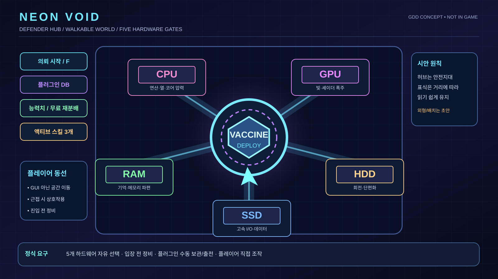
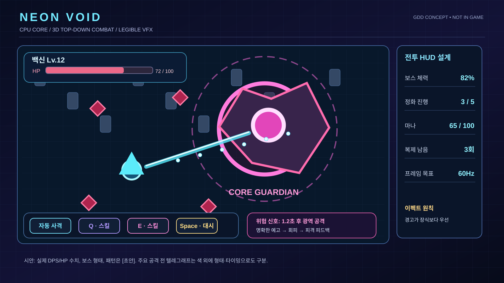
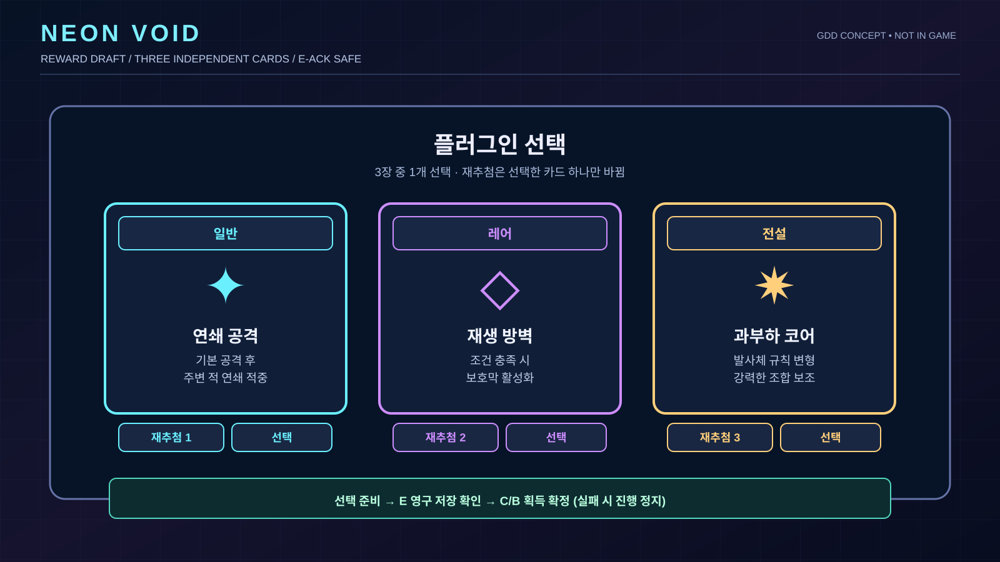
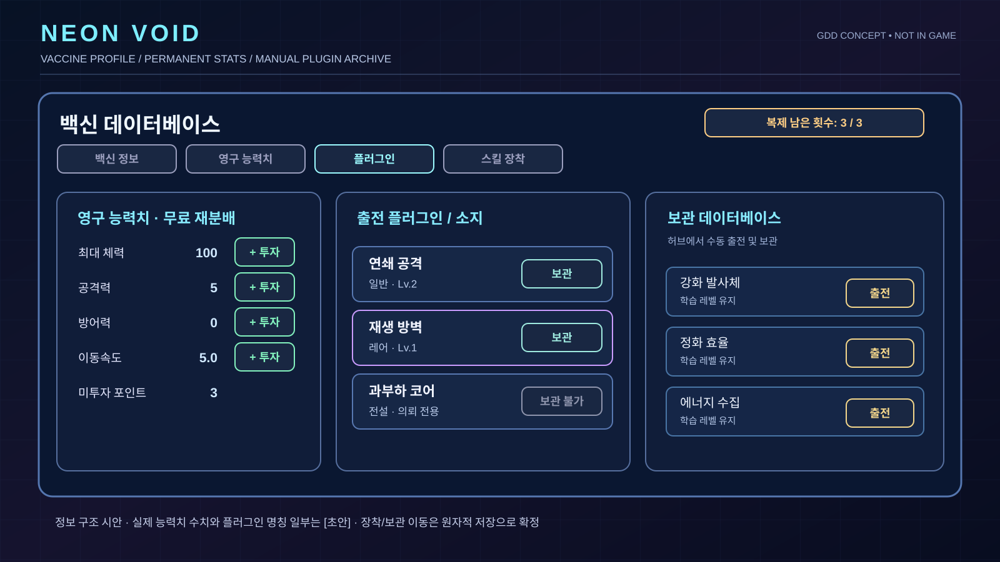
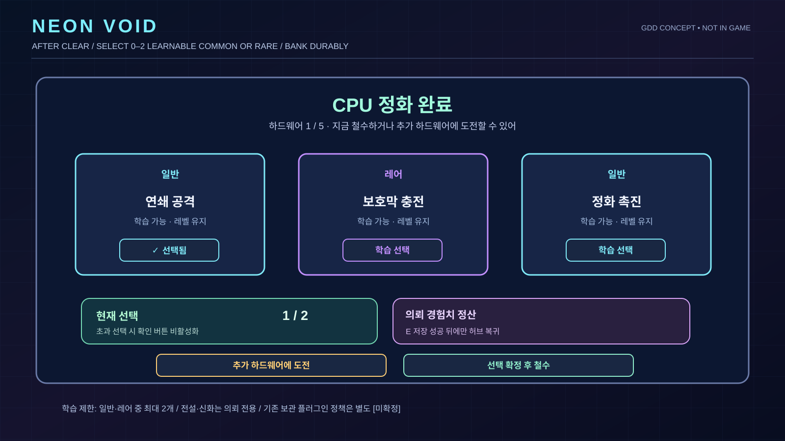
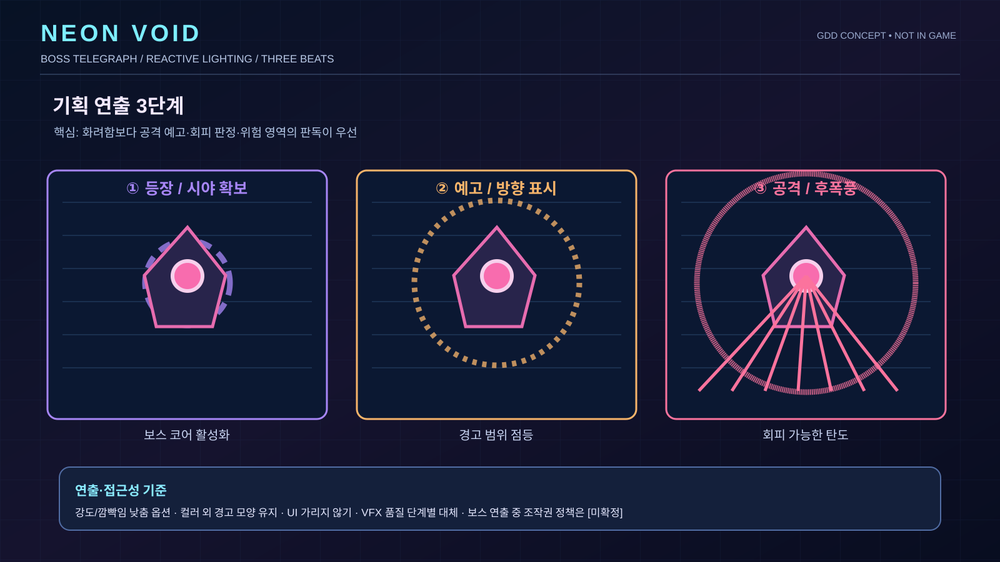

# Neon Void GDD — 화면/연출 콘셉트 시안

> **정의:** 전부 **기획용 이미지**, 실제 Godot 실행 장면·릴리스 UI 스크린샷 아님. 문서에 구현을 지시하는 그림이 아니라 **정보의 배치·위험의 가독성·연출 분위기**를 보여주는 목표 시안이다. 이미지의 가상 수치·캐릭터·보스 형태 및 색상은 **[초안]**.  
> **우선 규칙:** [NEON_VOID_GDD_V1.md](../../NEON_VOID_GDD_V1.md)의 [확정] 사항이 어떤 이미지보다 우선.

## 디자인 시안 목차

| 시안 | 이미지 | 주요 검토 포인트 |
| --- | --- | --- |
| 디펜더 허브 | [hub-world-concept.svg](hub-world-concept.svg) | 걸어서 접근하는 5개 하드웨어, 의뢰/DB/영구 성장/스킬 |
| CPU 전투 HUD | [cpu-combat-hud-concept.svg](cpu-combat-hud-concept.svg) | 마우스 조준, 위험 예고, 생존·전투 정보 우선순위 |
| 플러그인 보상 | [plugin-draft-ui.svg](plugin-draft-ui.svg) | 독립 3장, 카드 하나만 새로고침, E 저장 후 확정 |
| 백신 데이터베이스 | [vaccine-database-ui.svg](vaccine-database-ui.svg) | 소지/보관 분리, 무료 투자·재분배, 잔여 복제 |
| 학습 및 철수 | [extraction-ui.svg](extraction-ui.svg) | 일반·레어 최대 2개 학습, 영구 저장/추가 탐험 선택 |
| 보스 연출 | [boss-vfx-storyboard.svg](boss-vfx-storyboard.svg) | 등장→텔레그래프→피격, 회피 정보의 안정성 |

### 1. 디펜더 허브

### 2. CPU 전투와 HUD

### 3. 플러그인 3장 선택

### 4. 영구 성장·플러그인 DB

### 5. 성공 철수 및 학습

### 6. 보스 출현·공격의 3단계

## 코드로 옮기는 방법

1. 3D 월드와 2D `Control` UI를 분리. `scenes/rework/`의 실제 장면 구조가 위 시안의 정답이라고 가정하지 않음.
2. 색·여백·폰트·상태표시를 공통 Theme/디자인 토큰으로 관리.
3. 모니터 해상도 및 100~200% DPI에서 텍스트 대비·클릭 영역·레이어 순서 검증.
4. 보상 UI는 실제 E 저장 성공/ACK 및 C 카탈로그 데이터를 반영. 가상의 플러그인 수치나 시안 이름을 그대로 하드코딩하지 않음.
5. 보스 연출은 적 실제 피해·위험 면적·시뮬레이션 프레임과 일치해야 하며, 시각 옵션을 낮춰도 예고를 없애지 않음.
6. 외부 에셋을 가져올 때는 [에셋·플러그인 도입 가이드](../../ASSET_SOURCING_AND_INTEGRATION.md) 검증 절차 준수.

**저작/출처:** 이 디렉터리의 SVG 6개는 Neon Void 기획용 신규 오리지널 도식으로 작성. 타사 게임 스크린샷, 외부 유료 패키지 모델, 타사 상표 이미지는 포함하지 않는다.
